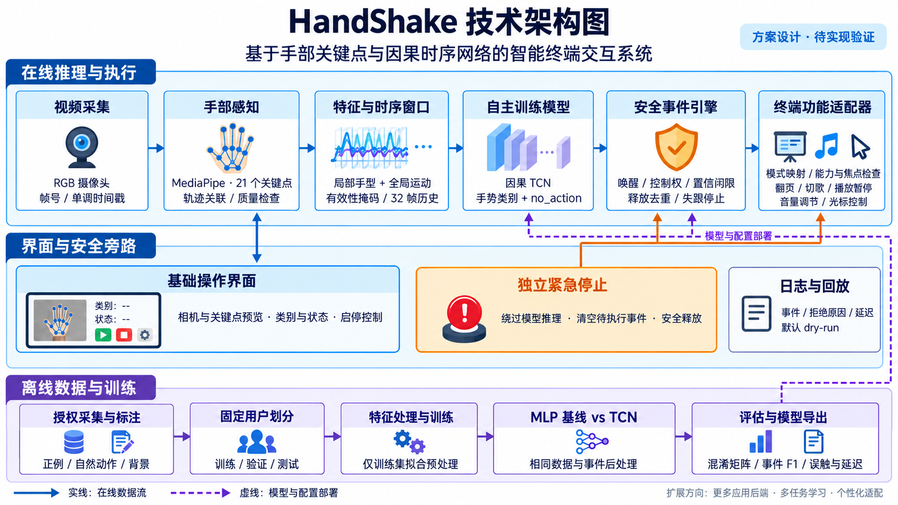

# HandShake：基于手部关键点与深度时序学习的意图感知终端交互系统

> **文档定位**：项目总目标、产品边界、研究路线、技术架构、实现细节、实验方案与答辩验收依据。
>
> **当前状态（2026-10-29）**：T01/T02/T05核心与协议草案、T03/T04/T06采集/感知/授权录制工具，以及T11/T12/T13共享特征、数据/缓存、规则/MLP/因果TCN模块均已实现。兼容依赖下真实MediaPipe模型加载/合成图像推理/关闭已通过，见 [感知修复](docs/perception_diagnostics.md)；特征与模型模块验证见 [T11/T12/T13记录](docs/verification_t11_t12_t13.md)。正式数据训练、公开数据类别迁移和完整实机验收仍待完成，尚无正式训练权重、产品UI或真实翻页；研究指标不是实验结果。
>
> **核心原则**：不是“MediaPipe 检测手 + 一堆 if/else”，而是以 MediaPipe 为感知前端，以自主训练的神经网络为识别与意图判断核心，以安全事件系统完成终端操作。

---

## 课程版执行约定（优先于后文研究扩展计划）

本文保留完整研究路线，但本次课程作业按本节范围验收。后文的三个场景、完整多任务模型、个性化和 12 周路线属于研究完整版；不自动成为课程版必做项。课程版优先级覆盖后文同名功能的研究优先级。

**当前用户约定（native-v2）**：改为可安装的原生多端应用，不要求浏览器。先交付电脑桌面版，随后实现 Android/iOS/iPadOS 本机识别与应用内控制；Windows/macOS/Linux 分平台实测，其他 OS 按 SDK/运行时能力评估，不承诺全系统任意跨应用控制。本约定替代此前 Web 目标。native-v2决策时仅改规划，后续代码实施另见本轮记录；保留T01/T02/T05历史证据，A/B分工待填。技术/权限边界见 [原生多端架构](docs/native_architecture.md) 与 [范围记录](docs/scope_freeze.md)；T36 早期选型、T20 桌面原生 UI、T37 移动本地运行、T38 可选配对控制。

### 最新数据约定 public-data-v1（优先于后文自采方案）

用户选择公开数据为主，不要求自行录制训练集；大文件留本地，仅提交官方URL、版本、许可与校验状态。首选IPN HandS关键点候选，标注小包SHA不一致尚待核验，不能称数据已可训练。首版拟保留来源类别，以UI/键盘明确启停、自训动态模型负责左右翻页；不强行把Open twice/Grab改成张掌/握拳标签。手势唤醒/退出成为后续增强，现有5类契约迁移另行实现。T07/T08改为公开数据适配预检与获取，自采规模为可选参考。完整执行/证据边界见 [公开数据方案](docs/public_data_plan.md)，来源见 [data/SOURCES.md](data/SOURCES.md)。

### 课程要求与待核实信息

依据课程要求图片整理：两人一组；使用机器学习或深度学习完成任务并提供界面；不能直接使用机器学习实验课上的内容；第 9 周前两节确定任务和方案并按顺序讲解设计思路；第 10 周答辩。每组共 10 分钟，其中讲述 8 分钟、提问 2 分钟。报告需写清背景、目标、方案、数据预处理、测试结果、组员及分工，以 PDF 附件上传学习通；每人讲解自己的工作，并至少准备一个向他组提出的问题。

图片中的各班具体节次应由组员对照课程通知确认，不据此推算公历日期。

| 信息 | 当前记录 |
| --- | --- |
| 组员 A / 学号 | 待填写 |
| 组员 B / 学号 | 待填写 |
| 班级、方案汇报时间、答辩时间、PDF 提交截止时间 | 待按课程通知填写 |
| 首个实测系统、桌面协议及演示软件 | 待实机确认 |
| 已完成的机器学习实验课题目 | 待填写；在选题冻结前核对 |

选题差异说明需列出“实验课已有任务/数据/方法”和“本项目新增任务/公开数据适配/时序识别/连续事件控制”。本项目拟以连续手势翻页及防重复触发为任务，但在获得实验课题目清单前，不宣称已经确认无重复；若有重叠，应调整任务并按课程要求确认。

### 最小课程交付范围

- **P0 必做**：一个实测桌面平台上的手势翻页；原生基础界面包含摄像头与关键点预览、预测类别、控制状态、启停和紧急停止；T36 原生选型/接口；自主训练的小型因果 TCN；MLP 基线；明确启用、释放去重和失跟停止；可复现数据处理与评估。
- **P0 词表**：按公开数据真实类别和方向证据冻结；IPN HandS候选保留14手势＋非手势，应用仅消费经核对的左右动作。启用/停止由UI和键盘提供，张掌唤醒/握拳退出不强制进入首版；不伪造公共数据未提供的标签，主模型输出实际参与在线翻页决策。
- **P0 实验**：固定按用户分组的训练/验证/测试划分；MLP 与 TCN 使用相同数据、特征及事件后处理；报告混淆矩阵、每类 Precision/Recall、Macro-F1、事件 Precision/Recall/F1、重复触发、自然活动误触次数与实际测试时长，以及目标机器上的端到端延迟和失败案例。
- **P1 后续产品/选做**：T37 原生手机本地运行及其他桌面平台移植为后续产品交付，不是取消手机目标；局部/全局分支对照、意图或阶段头、光标、音乐控制按资源选做。均不成为课程 P0 的全平台交付门槛。
- **P2 后续研究/可选扩展**：T38 手机与电脑配对控制、少样本适配、系统性开放集比较、图网络、自监督、双手交互、其他 OS 探索和完整研究消融。

课程版不以三个场景全部完成、24 人数据集、全部消融或少样本实验作为结课门槛。保留紧急停止、失跟停止和数据防泄漏要求，不通过缩减这些要求赶工。研究目标中的 F1、误触率和延迟数字均不是已测结果，课程报告应如实填写实测值。

### 两人分工与个人证据

以下为建议责任分配，填入真实姓名后冻结；两人均承担代码和实验工作，不能由一人只制作报告或观看另一人开发。

| 成员 | 主责及可核验交付 | 个人实验与讲解 |
| --- | --- | --- |
| A（待填姓名） | 特征处理、数据划分、MLP/TCN 训练和评估脚本、模型导出 | 解释预处理与模型；提交基线对比、混淆矩阵及失败分析 |
| B（待填姓名） | 相机与关键点采集、基础界面、状态机、翻页后端和停止机制 | 解释在线链路；提交重复触发、自然误触、失跟停止和延迟测试 |
| 两人共同 | 公开数据许可/类别映射与质量复核、接口集成、结果核查、报告与彩排 | 各自说明做了什么、如何做、遇到的问题及解决办法；各准备至少一个向他组提出的问题 |

在报告中记录各人负责文件、提交记录、实验配置与输出位置；最终按实际贡献更新，不把建议分工当作已完成事实。

### 课程节点与退出条件

| 节点 | 必须交付 |
| --- | --- |
| 第 9 周前两节的方案确认节点 | 任务及实验课差异说明、组员分工、单场景范围、界面草图、模型与数据方案、实施安排；按课程顺序讲解设计思路 |
| 方案确认后至答辩前（按实际可用时间安排） | 公开数据获取/适配与固定划分 → MLP/TCN → 界面和 dry-run → 翻页闭环与停止测试 → 冻结模型与测试结果 |
| 第 10 周本班答辩前 | 8 分钟讲述彩排、两人个人讲解、现场演示与明确标注的录播备份、结果图、失败分析及提问准备 |
| 课程通知规定的报告截止前 | 填入姓名学号与实际分工，导出并检查 PDF，以附件上传学习通；核对附件与提交状态 |

实际剩余时间不足时先削减 P1/P2，保留一个完整场景及必要实验；本表不假设方案确认后还有完整 12 周。

---

## 目录

1. 项目定位与总目标
2. 需求分层与产品范围
3. 场景、手势语言与交互原则
4. 研究问题与创新主线
5. 总体技术架构
6. MediaPipe 感知层设计
7. 特征工程与时序数据表示
8. 深度学习模型设计
9. 意图识别、开放集拒识与防误触
10. 多人场景、控制权与个性化
11. 光标及连续控制算法
12. 事件引擎与操作系统适配
13. 数据集采集、标注与管理
14. 模型训练与优化流程
15. 实验设计、评价指标与消融
16. 软件工程结构与模块接口
17. 配置、日志、可视化与调试
18. 性能、稳定性与异常恢复
19. 隐私、安全与使用边界
20. 测试体系与验收标准
21. 分阶段实施路线
22. 风险清单与降级策略
23. 答辩材料、演示与成果交付
24. 首批执行清单
25. 待确认事项与参考资料

---

## 1. 项目定位与总目标

### 1.1 名称建议

- 项目简称：**HandShake**。
- 产品名称：**HandShake 智能手势终端控制系统**。
- 答辩题目：**基于手部关键点与多任务时序网络的低误触智能交互系统设计与实现**。
- 如果个性化实验充分，可突出“跨用户泛化与少样本适配”。题目以实际成果为准，不把未验证模块写成既成创新。

### 1.2 一句话目标

通过普通摄像头获取手部运动，在 MediaPipe 输出的关键点之上训练深度学习模型，识别手势类别、操作意图和动作边界，在低延迟、低误触、可解释的约束下控制电脑等终端的光标、演示文稿、音乐及其他常用功能。

### 1.3 本质上需要解决的问题

1. 画面中哪些手被可靠检测到？
2. 当前手属于哪一条持续交互轨迹？
3. 谁被允许控制设备？
4. 用户是在自然活动，还是有意发出指令？
5. 指令是什么，何时开始、成立和结束？
6. 当前模式与应用是否允许执行？
7. 不确定、遮挡、多人冲突、焦点变化时如何安全地不执行？
8. 不同用户手型、速度和习惯不同，如何用少量校准适配？

### 1.4 最终成果

- 实时采集、关键点提取、轨迹关联和质量控制模块。
- 有明确采集与标注规范的静态、动态、自然负样本数据集。
- 至少一套自主训练并用于在线推理的时序神经网络。
- 手势分类、意图识别、动作阶段识别及事件触发闭环。
- 唤醒、控制权锁定、拒识、去重、释放与紧急停止机制。
- 光标控制、PPT 翻页、音乐控制三个核心场景。
- 可配置映射与可扩展的平台适配器。
- 跨用户泛化和少样本个性化对照实验。
- 可视化界面、日志、录制与确定性回放工具。
- 基线、消融、真实误触测试、用户任务测试和答辩材料。

### 1.5 成功标准

- **算法有效**：学习方法相对于规则、单帧模型的收益可测量。
- **系统可用**：实时摄像头下完成实际任务，不用预录结果冒充实时效果。
- **风险受控**：误触、重复触发、失跟恢复有专门测试。
- **泛化可信**：按用户/会话划分数据，避免相邻帧泄漏。
- **创新可证**：每项主创新均有研究问题、方法、对照与结果。
- **工程可复现**：采集、训练、导出、部署及配置版本可追踪。

---

## 2. 需求分层与产品范围

### 2.1 优先级

- **P0**：核心闭环，必须实现、测试和演示。
- **P1**：主要研究增强或明显改善体验的能力。
- **P2**：扩展探索，不能挤占主线验证时间。

### 2.2 功能清单

本表为研究完整版优先级；课程版采用文首执行约定，光标和音乐控制降为选做，翻页及基础界面为必做。

| 模块 | 功能 | 优先级 | 约束 |
| --- | --- | --- | --- |
| 感知 | 普通 RGB 摄像头检测和跟踪手部 | P0 | 不依赖专用硬件 |
| 识别 | 静态、动态手势识别 | P0 | 必须有训练模型参与在线决策 |
| 意图 | 自然动作与操作动作区分 | P0 | 学习模型加显式交互协议 |
| 防误触 | 唤醒、释放、冷却、取消、失跟保护 | P0 | 不允许每帧分类直接执行 |
| 光标 | 移动、单击 | P0 | 先稳定，再扩展复杂操作 |
| 演示 | 下一页、上一页 | P0 | 一次动作一次事件 |
| 音乐 | 播放/暂停、音量、上一首/下一首 | P0 | 后端能力可检测 |
| 控制权 | 单控制者锁定、冲突拒绝 | P0 | 其他人的手不能直接触发 |
| 配置 | 场景模式、动作映射、参数档案 | P0 | 物理动作与设备命令分离 |
| 停止 | 键盘/界面停止并释放所有按键 | P0 | 不依赖手势识别成功 |
| 拒识 | 已知无操作动作与未知动作抑制 | P1 | 不声称覆盖所有未知动作 |
| 个性化 | 几何校准、少样本适配 | P1 | 通用模型可回退 |
| 基础界面 | 相机、关键点、预测、模式/状态、启停及紧急停止 | P0 | 课程版必须交付 |
| 高级调试面板 | 置信度、意图、阶段、质量和拒绝原因统计 | P1 | 用于解释与调试 |
| 拖拽/滚动 | 按下保持、释放、连续滚动 | P1 | 必须先通过失效释放测试 |
| 多人 | 显式控制权转交 | P1 | 不允许不确定情况下自动抢占 |
| 双手 | 双手缩放、旋转、组合控制 | P2 | 单手系统稳定后再做 |
| 扩展 | 浏览器、阅读器、播放器插件 | P2 | 不承诺所有软件通用 |

### 2.3 非功能需求

- CPU 本地实时推理为主要部署目标，GPU 可用于训练。
- 摄像头断开、焦点变化、遮挡时不得遗留鼠标或键盘按下状态。
- 模型与平台分离，支持替换推理后端和操作系统后端。
- 默认本地处理；原始视频录制需要主动授权。
- 首次使用有短校准向导，当前模式和控制权始终可见。
- 支持左/右手偏好、活动幅度和确认时间调整。
- 每次执行和拒绝都能在日志中找到原因，但不默认保存敏感画面。

### 2.4 首版不做

- 完整手语翻译、无限词汇识别、医疗诊断。
- 仅凭关键点实现可靠现实身份认证。
- 未适配就承诺所有系统、所有应用可控制。
- 删除文件、支付、发送消息、管理员命令等高风险自动操作。
- 为展示“深度学习”而堆叠无法验证收益的复杂网络。

---

## 3. 场景、手势语言与交互原则

### 3.1 核心使用流程

**桌面光标**：启用光标模式 → 锁定控制手 → 指向移动 → 捏合单击 → 释放 → 退出。

要求：静止不明显抖动，快速移动不过度拖滞；点击尽量不引起位置跳动；失跟停止新操作；首版明确选定一个显示器。

**演示文稿**：进入演示模式 → 唤醒 → 左/右挥动 → 一次翻页 → 自然释放后重新武装。

要求：自然摊手、整理衣服、指屏幕不应频繁翻页；保持某个姿态不得持续重复翻页；方向映射可配置。

**音乐媒体**：进入音乐模式 → 唤醒 → 播放/暂停、切歌，或进入音量子模式。

要求：切歌是离散事件，音量是连续控制；音量有上下限与变化速率上限；不支持的命令明确报错。

### 3.2 初始手势词表

下表是候选方案，需要根据混淆矩阵、疲劳度和误触测试删减，不直接视为最终词表。

| 手势词元 | 类型 | 默认用途 | 风险与处理 |
| --- | --- | --- | --- |
| 张掌短时保持 | 静态+时间 | 请求唤醒 | 自然表达常见，需交互区域与明确模式约束 |
| 食指指向 | 静态 | 光标移动 | 仅在光标激活状态下有效 |
| 拇指食指捏合并释放 | 动态过程 | 单击/确认 | 闭合边沿触发，释放后才可重触发 |
| 向左挥动 | 动态 | 上一页/上一首 | 意图、轨迹、模式共同判断 |
| 向右挥动 | 动态 | 下一页/下一首 | 同上 |
| 独立的约定姿态保持 | 静态+时间 | 播放/暂停 | 必须与唤醒词元区分，试采集后确定 |
| 调节姿态下上下移动 | 连续动态 | 音量调整 | 显式进入音量子模式后才生效 |
| 握拳或专用停止姿态 | 静态+时间 | 退出交互 | 只是辅助，键盘紧急停止始终可用 |
| 放松/手离开 | 背景与边界 | 释放/空闲 | 与短暂失跟区分，不生成新命令 |

初期控制在 **6～10 个手势词元**，通过模式映射覆盖更多功能，不一次采集几十种相似动作。

### 3.3 手势与命令分离

```text
swipe_left + presentation -> previous_slide
swipe_left + music        -> previous_track
swipe_left + inactive     -> no_action
```

网络学习物理动作；映射层决定软件动作。换应用不必重新训练，且可以分别分析识别错误与映射错误。

### 3.4 三层交互协议

1. **控制层**：唤醒、取消、退出、控制权申请。
2. **模式层**：桌面、演示、音乐及其子模式。
3. **动作层**：点击、挥动、移动等。

首版优先用界面或热键切模式，不让网络隐式决定所有模式切换。后续再研究手势切换的双阶段确认。

### 3.5 用户反馈

- 灰色：禁用、无控制手。
- 黄色：候选动作、等待确认、质量不足。
- 绿色：已激活，可以执行。
- 红色：停止、冲突、失跟、执行失败。
- 同时显示模式、轨迹、最近事件与拒绝原因。

---

## 4. 研究问题与创新主线

### 4.1 总体研究假设

> 在相同关键点输入与近似实时计算预算下，将局部手型、全局运动、操作意图和动作阶段联合建模，配合控制权与安全状态机，相比单帧规则或单任务分类网络，可以获得更好的跨用户事件识别表现和更低的真实误触率。

这是待检验的假设，不是预先宣布的实验结论。

### 4.2 主线一：局部—全局解耦的多任务因果时序网络

**问题**：原始坐标容易记住位置、距离和手型；过度归一化又会删掉挥动方向与轨迹。

**方法**：

- 局部分支提取归一化手型、骨向量、关节角度。
- 全局分支保留掌心轨迹、方向、尺度变化、帧间隔与质量信息。
- 因果时序编码器建模动作过程。
- 多头同时预测类别、意图和阶段。

**对照**：原始坐标 → 仅局部 → 局部+全局 → 加时序 → 加多任务。

**待证明收益**：跨用户泛化更好；相近手型的动态动作更易区分；动作边界更稳定。

### 4.3 主线二：意图感知与不确定性门控的低误触交互

**问题**：挥手、捏物、指物可能像指令；未见动作也可能被网络高置信度误分类。

**方法**：

- 采集大量自然活动和相似动作负样本。
- 学习意图与动作阶段，而非只学类别。
- 使用概率校准、开放集拒识候选方法。
- 按操作风险组合控制权、模式、质量、阶段和确认条件。
- 在连续时间流上评估误触，不只评估裁剪动作片段。

**对照**：分类直接触发 → 固定门限 → 意图头 → 阶段头 → 拒识+安全状态机。

**待证明收益**：在相近事件召回率下，降低非操作时间的错误事件数。

**边界**：视觉模型不能读心。完全相同的可见动作可能有不同真实意图，必须依靠显式激活和上下文解决不可观测歧义。

### 4.4 主线三：少样本个性化适配

**问题**：手型、惯用手、动作幅度、速度和抖动程度存在个体差异。

**方法**：

- 先做几何、活动区域和交互阈值校准。
- 每类采集少量样本，建立用户动作原型或微调小型适配层。
- 通用模型保持可回退，不在在线运行中盲目自训练。

**对照**：通用模型、仅校准、少样本原型、小规模微调；比较每类 1/3/5/10 个样本的收益。

**待证明收益**：较少校准时间改善困难用户的任务完成率。

**边界**：个性化档案、匿名轨迹和真实身份是三个不同概念。关键点匹配不能用于敏感身份认证。

### 4.5 扩展创新储备

| 方向 | 做法 | 优先级 |
| --- | --- | --- |
| 质量感知融合 | 对噪声/遮挡片段降权，训练时加入缺失掩码 | P1 |
| 置信度自适应平滑 | 质量高时降低控制延迟，质量差时保守抑抖 | P1 |
| 主动学习 | 优先标注高熵、冲突、误触片段 | P1 |
| 自监督预训练 | 关键点掩码重建、时序对比 | P2 |
| 动作风格嵌入 | 用于适配或辅助同轨迹连续性，不当作认证 | P2 |
| 双手协同 | 一只手保持激活，另一只手控制 | P2 |
| 图时序模型 | 利用手部骨骼拓扑与时序依赖 | P2 |

### 4.6 创新表述纪律

- “使用 MediaPipe”“加入神经网络”本身不等于原创算法。
- 主线应有方法级设计、针对性实验和边界分析。
- 控制权、适配器、可视化可以作为工程贡献，不自动包装成全新理论。
- 文献调研前使用“拟研究”“本系统组合设计”，不声称“首次提出”。
- 最终选 2～3 个有结果的创新讲透，不把所有候选都列为完成项。

---

## 5. 总体技术架构

通用技术架构示意图（方案设计，非已实现成果；翻页、音乐与光标共用终端功能适配层，课程必做范围仍以文首约定为准）：



图中紫色虚线表示离线模型与配置部署，目标仅为在线模型和事件门限配置，不进入独立紧急停止逻辑；紧急停止独立于模型。该图保留通用算法/控制链路，不代表已画出移动壳、便携运行时或配对网络，原生部署以第 5.5 节及原生架构文档为准。

### 5.1 在线链路

```text
摄像头 + 采集时间戳
  -> 最新帧槽/有界队列
  -> MediaPipe 手部关键点
  -> 轨迹关联、控制权管理
  -> 质量评估、局部/全局特征
  -> 每条轨迹独立的因果时序缓冲区
  -> 自训练时序网络
       ├─ 手势类别
       ├─ 操作意图
       ├─ 动作阶段
       └─ 嵌入/拒识辅助分数
  -> 概率校准、拒识、候选平滑
  -> 安全状态机和事件引擎
       ├─ 离散事件：翻页、点击、切歌
       └─ 连续控制：光标、音量、滚动
  -> 模式映射、能力检查、平台适配器
  -> 终端操作
```

旁路：界面、配置、紧急停止、健康监控、日志、录制与回放。

### 5.2 离线链路

```text
授权采集/导入
  -> 关键点提取及版本记录
  -> 连续时间轴标注与质量审核
  -> 按用户/会话固定划分
  -> 仅使用训练集拟合预处理统计量
  -> 基线与主模型训练
  -> 验证集校准、阈值选择
  -> 固定测试集评估
  -> 导出、数值一致性与部署实测
```

### 5.3 三条架构边界

- **感知不等于授权**：检测到一只手，不代表这只手可以控制。
- **预测不等于事件**：每帧识别到同一动作，不代表每帧执行。
- **事件不等于系统调用**：`next_slide` 通过后端映射，不在模型内写快捷键。

### 5.4 运行模式

| 模式 | 用途 | 是否真实执行 |
| --- | --- | --- |
| `collect` | 采集、标注辅助 | 否 |
| `train` | 训练、离线评估 | 否 |
| `replay` | 回放并复现决策 | 默认否 |
| `dry_run` | 实时识别，记录拟执行动作 | 否 |
| `live` | 授权后的真实控制 | 是 |

开发默认 `dry_run`，防止调试或测试意外操作桌面。

### 5.5 原生多端部署

```text
桌面原生 UI / 手机原生 UI
  → 平台相机与感知适配
  → 标准观测 → 特征/时序窗口 → 自训模型运行时
  → 安全状态机/调度器
  → 本应用内适配器 / 获授权的系统与外部应用适配器
```

Python 为训练/桌面参考核心；手机部署便携模型与本地运行核心，不要求桌面 Python UI 或电脑服务。T36 冻结 UI/桥接路线，T37 用 golden fixtures 验证跨实现特征、窗口、logits、事件与停止语义；T38 才按需增加原生手机→已配对电脑 Agent 的认证命令通道。逻辑分层不强制微服务，默认本机离线运行。

区分“安装、相机、本地识别、应用内控制、外部控制、分发”各层兼容性。手机后台/锁屏/权限撤销默认停止，恢复不自动 live；跨设备必须有执行端 watchdog，不能直接比较两端单调时钟。详见 [原生多端架构与验收](docs/native_architecture.md)。

---

## 6. MediaPipe 感知层设计

### 6.1 职责划分

MediaPipe 提供手部检测、21 个关键点、左右手类别及所选 API 可用的其他输出。自主模型负责动作、意图、阶段和用户适配，不用现成 Gesture Recognizer 的结果冒充自主训练成果。

### 6.2 正确理解输出

- 图像 landmark 的 `x、y` 通常为归一化坐标，但投影点可能越界，不应假设严格落在 `[0, 1]`。
- 图像 landmark 的 `z` 是相对深度表示，不等于摄像头到手的厘米距离。
- world landmarks 即使使用米制表示，也主要是估计的手部三维结构，不等于可靠的相机世界定位。
- handedness 分数是左右手分类可信程度，不是每个关键点的定位置信度。
- 不同 API/版本暴露的检测、存在、跟踪信息不同，适配层必须核实，不凭空构造逐点置信度。
- 镜像预览、模型输入和左右手语义必须统一，并用实机测试验证。

### 6.3 关键点结构

- `0`：手腕。
- `1–4`：拇指。
- `5–8`：食指。
- `9–12`：中指。
- `13–16`：无名指。
- `17–20`：小指。

固定骨骼连接表用于骨向量、夹角、图网络和异常检查。

### 6.4 感知数据契约

```text
HandObservation
  frame_id
  timestamp_ns                 # 采集时刻，单调时钟
  image_size
  track_id                     # 系统关联产生，不是真实身份
  landmarks_image[21, 3]
  landmarks_world[21, 3]?       # 所选 API 支持时使用
  handedness_label
  handedness_score
  bbox_derived                 # 从关键点推导，不冒充原始检测框
  validity_mask
  quality_features
  transform_metadata           # 镜像、裁剪、缩放等
```

### 6.5 质量控制

检查缺失、非有限数值、手部过小、接近画面边缘、骨长比例突变、位移异常、尺度突变和轨迹关联歧义。

初期质量分数由实际可用输出与几何/时序规则构建，不能描述为已校准概率。若后续训练质量头，必须补充人工质量标签或明确监督来源。

### 6.6 时间戳和推理模式

- 内部延迟使用单调时钟，避免系统时间调整影响测量。
- MediaPipe 视频/实时接口按要求使用递增时间戳并转换单位。
- 异步结果需要校验帧号和采集时间，丢弃晚到旧结果。
- 先选定一种主调用方式跑通闭环，再比较同步、异步实现。

---

## 7. 特征工程与时序数据表示

### 7.1 特征设计原则

原始 63 维坐标包含手型、位置、距离、视角等混合信息。应保留原始数据，构造可复现的局部与全局表示；不为追求特征数量而盲目拼接。

### 7.2 局部归一化

设第 `i` 个点为 `p_i(t)`，中心为 `c(t)`，尺度为 `s(t)`：

```text
c(t) = 手腕 或 稳定的掌心关键点均值
s(t) = 多条掌部骨长/掌宽的稳健组合
p_local_i(t) = [p_i(t) - c(t)] / max[s(t), epsilon]
```

实现细节：

1. 尺度计算方法固定并记录版本。
2. 尺度过小则判低质量，不将噪声放大后继续执行。
3. 图像几何距离先处理宽高比，避免 `x、y` 归一化产生形变。
4. `z` 与平面坐标的尺度处理遵循 API 定义，不当作精准真实三维坐标。
5. 若转到掌坐标系消除旋转，另保留掌朝向特征。
6. 若将左手镜像成右手模板，必须同步处理方向标签与全局运动语义。

### 7.3 局部手型分支

候选特征：

- 归一化关键点。
- 骨向量、单位骨方向。
- 关节夹角或夹角余弦。
- 指尖到掌心、指尖之间的归一化距离。
- 拇指—食指捏合距离。
- 掌朝向及局部坐标一阶差分。

以归一化坐标为基础，逐项消融确定其他特征是否值得保留。

### 7.4 全局运动分支

保留腕部/掌心图像位置、位移、速度、加速度、短中期轨迹、掌部尺度及变化率、方向变化、边缘距离、帧间隔、有效性和质量。

这部分不能被局部平移归一化抹掉，否则无法可靠区分左右挥动，也无法控制光标。前后移动涉及单目歧义，首版不依赖精准深度操作。

### 7.5 时间归一化

```text
v(t) = [c(t) - c(t-1)] / delta_t
```

- 不假设所有帧严格相隔 `1/30` 秒。
- 帧间隔异常时不直接求导。
- 先处理离群值再差分，避免噪声放大。
- 连续控制按真实时间积分，不能让帧率决定音量变化速度。

### 7.6 时序窗口

| 窗口 | 初始范围 | 用途 |
| --- | --- | --- |
| 短窗口 | 8～16 帧 | 低延迟姿态/意图变化 |
| 主窗口 | 16～32 帧 | 挥动、捏合等常见动作 |
| 长窗口 | 32～48 帧 | 需要更长上下文的阶段识别 |

以约 30 Hz 为起点，但实际按时间戳处理。模型必须因果，只用当前和历史信息。

32 帧覆盖约一秒历史，不代表每次预测都要额外等一秒；流式模型持续输出。但冷启动、完整轨迹观察、确认时间仍会造成延迟，要单独测量。

### 7.7 缺失处理

- 输入必须带有效性掩码和缺失时长。
- 短缺失可用保守保持或历史外推，不能在线使用未来帧插值。
- 长缺失清除候选、挂起控制，必要时重置缓冲区。
- 重现的手不能自动接续失跟前的拖拽或未完成点击。
- 训练增强应模拟噪声、掉帧和遮挡。
- 离线与在线预处理保持一致，避免离线双向平滑造成虚高效果。

### 7.8 模型随附的特征协议

```text
feature_schema_version
mediapipe_api_and_version
coordinate_convention
mirror_policy
handedness_policy
feature_order
normalization_parameters
sampling_policy
window_length
class_mapping
```

运行时不匹配则拒绝加载，不能只检查维度相同。

---

## 8. 深度学习模型设计

### 8.1 模型路线

| 编号 | 模型 | 作用 |
| --- | --- | --- |
| B0 | 角度、距离、轨迹规则 | 工程与误触基线 |
| B1 | SVM/随机森林/小型 MLP | 验证单帧特征可学习性 |
| B2 | 单分支 GRU 或因果 TCN | 验证时序信息收益 |
| M1 | 双分支因果 TCN + 多任务头 | 推荐主模型 |
| M2 | 手部图卷积 + TCN | 验证骨骼拓扑收益，备选 |
| M3 | 轻量因果 Transformer | 数据量和资源允许时再比较 |

规则始终保留为基线和安全约束，但不能成为最终识别系统唯一依据。

### 8.2 推荐主模型：LG-MT-TCN

内部工作名：**Local–Global Multi-Task Temporal Convolutional Network**。名称是本项目结构简称，不预设其为原创理论或已有实验成果。

输入：

```text
X_local  ∈ R[B, T, D_local]
X_global ∈ R[B, T, D_global]
M_valid  ∈ {0,1}[B, T, D_mask]
```

其中 `B` 为批大小，`T` 为历史长度，特征维度由版本化 schema 决定。

结构草案：

```text
局部关键点/骨特征
  -> 帧级 MLP (例如 D_local -> 64 -> 96)
  -> 因果残差 TCN
                             ┐
                             ├-> 拼接 + 线性投影/轻量门控 -> 共享表示 h(t)
                             │                           ├-> 类别头
全局轨迹/时间/质量           │                           ├-> 意图头
  -> 帧级 MLP (D_global -> 32 -> 64)                      ├-> 阶段头
  -> 因果残差 TCN            ┘                           └-> 嵌入头（可选）
```

初始搜索范围：

- 卷积核大小 `3`。
- 扩张率 `[1, 2, 4, 8]` 或较短配置。
- 隐藏通道约 `64～128`，先保证小模型可训练。
- dropout 约 `0.1～0.3`，由验证结果决定。
- 采用残差连接、稳定归一化与必要的梯度裁剪。
- 避免跨未来时间点统计或注意力泄漏；Transformer 备选必须使用因果掩码。

课程版首个可复现配置固定为：输入历史 32 帧、卷积核 3、4 个残差块，扩张率依次为 `[1, 2, 4, 8]`，每块仅一层时序卷积，步长为 1，感受野为 31 帧。每层只在左侧补零；训练和在线窗口采用相同规则。冷启动或长失跟后，连续 32 个有效观测完成预热，预热中无效/超允许间隔则重新计数；之后短缺失保留掩码，但当前失效时不执行，恢复还须检查窗口有效比例、时间跨度与新鲜度。ready 不代表自动恢复控制权，具体协议见 T11/T16。若改为每块两层卷积，感受野为 61 帧，需同步调整窗口、缓存、训练和冷启动，不能沿用 32 帧后声称拥有完整历史。

TCN 感受野由实际卷积层数决定：每层一层卷积时，步长为 1 的感受野为 `1 + Σ(k_l-1)d_l`；若一个残差块包含两层卷积，二者都要计入。输入窗口、训练切片和在线缓存必须与感受野一致。

### 8.3 输出头

**类别头**：输出 `K` 个命令词元与一个明确的 `no_action` 类。

**意图头**：输出处于约定操作过程的分数。自然挥手、捏物等应有意图负标签，不能把“看起来像命令”都标成正例。

**阶段头**：初始使用 `background / preparing / active / releasing`。动态动作可用阶段转移决定是否形成完整事件；不必为所有动作强行套相同触发时刻。

**嵌入头（可选）**：用于用户原型、距离拒识或对比学习。只有明确实验需求时加入。

### 8.4 多任务损失

```text
L = λ_cls L_class
  + λ_int L_intent
  + λ_phase L_phase
  + λ_aux L_aux
```

- `L_class`：交叉熵，可比较类别加权或 focal loss。
- `L_intent`：二元交叉熵，考虑正负不均衡。
- `L_phase`：有掩码的阶段交叉熵。
- `L_aux`：可选的监督对比、质量或边界损失，不默认全部启用。
- 没有标签的任务用 mask 跳过，不能把缺失标签当作负例。
- λ 由验证集或有记录的权重策略选择，检查是否某头压制其他任务。
- 不同时无依据地使用强重采样、强类别权重和 focal loss，避免过补偿。

### 8.5 模型比较原则

- 使用相同用户划分、特征版本和可比训练预算。
- 单帧模型评估分类能力；端到端比较时给各模型相同事件后处理，另单独消融后处理。
- 报告参数量、MACs（工具口径明确）、实际推理耗时、内存。
- 不只比较准确率，重点比较固定召回率下的误触和用户级表现。
- 更复杂网络若没有稳定收益，应保留简单模型。

### 8.6 为什么首选 TCN

- 对短时关键点序列通常有合适的计算成本。
- 支持因果、流式部署，训练易并行。
- 可解释不同时间尺度的作用，适合做结构消融。
- 相对大型 Transformer，对本项目初期数据规模更稳妥。

这只是工程起点，不预先断言 TCN 一定优于 GRU 或图网络。

### 8.7 扩展研究的正确顺序

1. 完成 MLP、GRU/TCN 基线。
2. 加局部—全局双分支并测收益。
3. 加意图与阶段多任务。
4. 完成拒识、真实事件评估。
5. 再研究图结构、自监督或少样本适配。

不先做十个复杂模块，最后无法定位收益来源。

---

## 9. 意图识别、开放集拒识与防误触

### 9.1 三类非执行情况必须区分

1. **背景/已知无操作**：训练中见过的自然放松、打字、捏物等。
2. **未知动作**：不属于命令词表、可能未在训练中出现的动作。
3. **感知不可靠**：遮挡、关键点错位、轨迹混乱等。

`no_action` 训练类不能代表所有未知动作，低质量也不能简单混同为普通背景。

### 9.2 分层防误触链路

```text
质量合格？
  -> 当前有明确控制者？
  -> 系统和场景已启用？
  -> 手势与意图达到相应门限？
  -> 没有被未知动作拒识？
  -> 阶段和时间证据足够？
  -> 已从上次动作释放，且通过去重/冷却？
  -> 目标后端、焦点、权限仍符合要求？
  -> 执行
```

任何条件失败均不生成新的设备命令；安全释放不受普通命令门限阻碍。

### 9.3 概率校准与拒识

初期比较：

- 最大 softmax 概率阈值。
- 温度缩放后的最大概率阈值。
- energy score：`E(x) = -T log Σ exp(z_k/T)`。
- 特征到已知类别原型的距离。

注意：

- 校准温度、拒识阈值只在独立验证集上选。
- 明确分数方向、类别范围和接受条件，不混淆“分数越大越可信”。
- 概率校准改善已知分布可信度，不等于自动获得分布外检测能力。
- 意图、类别和质量通常相关，不能把三个分数相乘就声称得到了可靠联合概率。
- 初版采用可解释的独立门限和逻辑组合；若训练融合门控器，需要独立训练/验证数据。
- 未知动作验证集用于方法选择；最终未知测试集应包含未用于调参的动作族。

### 9.4 安全状态机

| 状态 | 含义 | 允许的行为 |
| --- | --- | --- |
| `DISABLED` | 软件未启用控制 | 检测/预览，禁止设备操作 |
| `IDLE` | 已启用，无控制者 | 等待唤醒和控制权申请 |
| `ARMING` | 验证唤醒候选 | 累积证据，失败则返回 |
| `ACTIVE` | 已锁定控制者 | 允许符合当前模式的候选动作 |
| `CANDIDATE` | 动作尚未确认 | 只显示，不执行 |
| `EXECUTING` | 事件提交或连续控制 | 严格执行当前允许动作 |
| `WAIT_RELEASE` | 离散动作已触发 | 等待释放，拒绝同一次动作重触发 |
| `COOLDOWN` | 短时抑制区间 | 不接受新的同类离散动作 |
| `SUSPENDED` | 失跟、冲突、质量异常 | 停止控制并安全释放 |

紧急停止是跨状态的最高优先级动作：立即禁用新事件、撤销待执行候选、释放按下状态并回到 `DISABLED`。

### 9.5 关键状态转换

- 唤醒必须持续一段真实时间且轨迹稳定，才能从 `ARMING` 进入 `ACTIVE`。
- 候选不一致、超时或质量下降时取消，不“凑够几帧就执行”。
- 离散动作提交后进入 `WAIT_RELEASE`，明确释放后才可再次武装。
- 冷却结束本身不能让持续保持的姿态再次执行，必须有释放证据。
- 长时间无操作自动退出或挂起，超时可配置。
- 失跟、控制者冲突、焦点不符均进入保守状态。
- 恢复后重新验证控制权；长失跟不得自动恢复先前按下状态。

### 9.6 时序防抖与滞回

可使用：

- 最近 `N` 次有效预测中至少 `M` 次同意。
- 连续成立时间 `hold_ms`。
- 启动高阈值 `τ_on`、保持低阈值 `τ_off`，且 `τ_on > τ_off`。
- 动作阶段必须呈现合理顺序。
- 捏合闭合距离小于 `d_close`、释放距离大于 `d_open`，其中 `d_close < d_open`。

默认优先以毫秒为单位，而不是写死帧数。所有门限只是初始搜索参数，必须通过验证集优化。

### 9.7 事件去重

每个离散事件包含：

```text
event_id, track_id, gesture_id, candidate_start,
commit_timestamp, mode, model_version, decision_reason
```

- 事件引擎统一生成唯一 ID，适配器不自行重复解释预测。
- 已提交候选只能生成一次事件。
- 鼠标点击可封装为按下/释放事务，并用 `finally` 做释放保护。
- 保留最近提交 ID，防止队列重复投递造成重复操作。
- 注入结果不确定时不能盲目重试点击、翻页等非幂等动作，应记录不确定并要求下一次显式动作。

### 9.8 不同操作的风险策略

| 操作 | 确认要求 | 失败策略 |
| --- | --- | --- |
| 光标移动 | 已激活、姿态稳定、质量合格 | 停止移动或冻结，不外推到远处 |
| 单击 | 明确捏合边沿、较高意图门限 | 不确定不点击 |
| 翻页/切歌 | 完整动态证据、一次性事件 | 等释放，不自动重试 |
| 音量 | 明确子模式、限幅限速 | 停止累计，不补发历史变化 |
| 拖拽 | 明确进入、持续控制权 | 失跟或异常立即/按极短安全超时释放 |
| 敏感操作 | 首版禁用 | 后续也需设备侧明确确认 |

### 9.9 可解释拒绝原因

建议枚举：`LOW_QUALITY`、`NO_OWNER`、`MODE_BLOCKED`、`LOW_INTENT`、`UNKNOWN_GESTURE`、`WAITING_RELEASE`、`COOLDOWN`、`FOCUS_CHANGED`、`BACKEND_UNAVAILABLE`。

有了原因统计，才能区分“模型没认出”与“系统正确阻止了不安全动作”。

---

## 10. 多人场景、控制权与个性化

### 10.1 “不同人的手部判别”拆成三个问题

| 问题 | 可行方案 | 不能承诺的内容 |
| --- | --- | --- |
| 当前这只手是否延续上一帧同一条轨迹 | 时空关联、运动预测、关键点相似性 | 遮挡交叉后永远不换 ID |
| 哪只手拥有设备控制权 | 显式唤醒、轨迹锁定、接管协议 | 自动知道现实中的授权者是谁 |
| 哪个用户配置适合当前使用者 | 用户主动选档案、少样本校准 | 仅凭关键点可靠认证现实身份 |

MediaPipe 的检测结果顺序、左右手标签都不能直接充当跨帧身份 ID。两只手也不天然表明来自同一个人。

### 10.2 轨迹关联

初版：

- 从关键点推导掌心和边界框。
- 对已有轨迹做短时运动预测。
- 构造位置、尺度、骨架相似性和 handedness 的关联代价。
- 通过门限约束的匹配算法分配 ID，必要时使用 Hungarian assignment。
- handedness 作为软信息，不能因一次标签跳变立即换人。
- 不可能匹配则新建轨迹；长时间消失则销毁。

示意代价：

```text
C(i,j) = α·位置距离 + β·尺度差 + γ·归一化骨架差 + δ·左右手不一致代价
```

各项先统一量纲；阈值通过交叉、快速移动、遮挡序列验证。

### 10.3 交叉、遮挡和多手歧义

- 关联不确定时冻结控制，不能为保持“流畅”把控制权猜给另一只手。
- 长时间丢失后必须重新唤醒。
- 多个唤醒候选同时存在时拒绝自动选人，界面提示单独申请。
- 首版可限制交互区域和最大检测手数，明确多人能力边界。
- 人体检测/姿态可作为后续“手属于哪个人”的辅助，但会增加隐私、计算量与误关联，非 P0。

### 10.4 控制权协议

1. 系统明确启用后进入等待。
2. 只有一个稳定候选完成唤醒时授予控制权。
3. 控制者显示为匿名轨迹 ID。
4. 非控制手可被检测，但不进入动作执行链。
5. 当前控制者主动退出、长失跟或人工停止后释放控制权。
6. 新用户重新申请，不因手靠近摄像头而直接抢占。

### 10.5 用户档案与校准

用户主动选择或创建本地匿名档案，保存：

- 惯用手、镜像偏好。
- 舒适活动范围与屏幕映射。
- 捏合闭合/释放距离分布。
- 动作速度、确认时长、滤波参数。
- 可选的少样本原型/适配层及版本。

首次向导建议：静止 2～3 秒估计抖动 → 画出舒适范围 → 捏合数次 → 各动态动作少量演示 → dry-run 验证。具体时长以试用反馈调整。

### 10.6 少样本适配路线

**A. 几何校准**：无需训练，验证是否已经解决大部分差异。

**B. 原型适配**：冻结编码器，在嵌入空间计算各类用户原型，与通用分类结果按验证策略融合；嵌入需要具备类间可分性。

**C. 小头/适配层微调**：冻结主干，只更新少量参数；低学习率、早停、保留通用样本约束，避免灾难性偏移。

**D. 风格嵌入探索**：仅作为 P2；需要足够跨会话数据，防止学到摄像头条件而不是用户差异。

### 10.7 适配的安全边界

- 不将高置信预测自动当作真实标签长期自训练。
- 用户确认的样本才能进入个性化训练。
- 新适配器先经过回放或 dry-run 验证，再切换。
- 适配失败可一键回退通用模型。
- 不允许在最终测试集上挑选用户阈值。

---

## 11. 光标及连续控制算法

### 11.1 识别与控制解耦

网络决定“现在是否处于合法指向/点击/调节状态”；几何控制器计算坐标和变化量。首版不直接训练“关键点到屏幕像素”的黑盒回归器，因为该映射受屏幕布局和个人舒适区域影响很大。

### 11.2 绝对位置映射

从全局分支之前保留的原始图像指尖或稳定指向位置获得 `u、v`，经用户校准区域映射：

```text
x_screen = clamp((u-u_min)/(u_max-u_min), 0, 1) * (W-1)
y_screen = clamp((v-v_min)/(v_max-v_min), 0, 1) * (H-1)
```

- 不使用已减去腕部位置的局部坐标做绝对光标定位。
- 校准区域过小则拒绝保存，避免增益过高。
- 统一镜像方向、显示器原点、DPI 缩放和逻辑/物理像素。
- 模式激活时使用短暂接入或锚定策略，避免光标瞬间跳跃。

### 11.3 相对控制备选

采用手部位移映射光标增量，并设计“离合”手势重定位。可以缓解手臂活动范围限制，但会增加交互学习成本，作为 P1 比较而非同时强推两套默认方案。

### 11.4 平滑与抖动控制

比较无滤波、EMA、One Euro Filter、Kalman 等方案，重点报告抖动与延迟权衡。

推荐起点：

- 低速静止时更强平滑。
- 快速移动时降低平滑延迟。
- 小死区抑制微抖，但避免阻碍精细移动。
- 质量很差时停止，不靠无限平滑掩盖错误。
- 模式切换、失跟恢复后重置滤波状态。

### 11.5 点击和拖拽

- 捏合距离做手掌尺度归一化。
- 使用网络状态与几何边沿共同确认，几何特征不是唯一识别依据。
- 单击触发后等待张开，不因持续捏合重复点击。
- 点击时可短时锁定或降低位置增益，但需测试是否影响目标选择。
- 拖拽单独定义进入、保持、正常释放和故障释放，不由“长单击”随意推断。
- 故障释放具有最高优先级，不等网络给出正常 release 才执行。

### 11.6 连续音量/滚动

推荐速度控制形式：

```text
rate = gain * signed_displacement_outside_deadzone
value(t) = clamp(value(t-1) + rate * delta_t, min_value, max_value)
```

- 明确中性点和死区。
- 限制单次增量、每秒变化量和发送频率。
- 对只支持离散媒体键的后端维护小数累计量，量化为有限步进。
- 退出模式、失跟时清空累计量，不能恢复后补发旧变化。
- 后端无法查询实际音量时，不显示虚构的精确百分比。

### 11.7 人体工学

- 尽量允许肘部支撑、较小活动范围。
- 长时间保持张掌会疲劳，不要求整个使用过程持续举高手臂。
- 测量不同任务耗时和主观疲劳；体验差时缩减手势而非只调模型。

---

## 12. 事件引擎与操作系统适配

### 12.1 标准命令接口

```text
move_pointer(x, y)
click(button)
button_down(button)
button_up(button)
scroll(dx, dy)
next_slide()
previous_slide()
media_play_pause()
media_next()
media_previous()
adjust_volume(delta)
release_all()
```

模型模块不得直接导入平台事件注入库。所有真实操作经过一个命令调度器，统一限速、权限、去重和日志。

### 12.2 后端能力矩阵

| 平台/环境 | 初期策略 | 注意事项 |
| --- | --- | --- |
| Windows | 系统输入/媒体接口的独立适配器 | DPI、多显示器、权限等级、焦点 |
| Linux X11 | 合适的 X11/桌面自动化后端 | 依赖桌面环境与权限 |
| Linux Wayland | 优先合法 portal、受支持接口或应用内插件 | 不能承诺任意全局注入，不默认用 root 绕过 |
| macOS | 独立后端并申请辅助功能权限 | 不具备实机验证时不标为已支持 |
| Android | 原生相机/本地模型与本应用内控制；外部控制另用受支持 API | 不默认全局触控注入；敏感无障碍能力需单独授权、合规与实测 |
| iOS/iPadOS | 原生相机/本地模型与本应用内控制 | 普通 App 不能任意注入其他 App；仅支持明确的公开接口/集成 |
| 其他 OS / 无界面设备 | 按 SDK、相机与推理运行时新增适配 | 不假设具备 Python、Android 兼容层或全局输入权限 |
| 演示应用 | 明确快捷键映射或专用插件 | 不同软件快捷键和焦点行为有差异 |
| 音乐应用 | 标准媒体接口或应用插件 | 播放状态、全局媒体路由可能不同 |

当前开发目录位于 Linux 环境，但首个目标操作系统和桌面协议仍需确认。只在实测平台上声明支持。

### 12.3 焦点和应用白名单

- 演示控制只在允许的应用/模式中发送快捷键。
- 焦点变化时重新检查，不把“下一页”误变成其他程序中的方向键。
- 平台不支持可靠焦点查询时，采用明确手动模式、提示与保守禁用策略。
- 全局媒体操作可以独立配置，但仍需用户明确授权。

### 12.4 原子性与失败处理

- 鼠标点击封装为带释放保护的事务。
- 调度器维护已确认及“可能已按下”的集合；发出按下前登记，超时/异常不能推定没有副作用，故障时均需安全释放。
- 停止与普通命令有串行提交边界，分别记录停止接收、禁新提交、释放确认；已开始的外部调用未必可撤销，线程超时不等于底层调用取消。
- 连续绝对位置可最新覆盖，速率由单一控制器积分；相对音量/滚动 delta 不可直接覆盖丢弃，必须限幅合并并在失效时清空。
- 执行失败应记录原因，不能无界重试。
- 普通日志失败不能阻止 `release_all()`。
- 紧急停止、进程退出、摄像头异常和长失跟都应走同一安全收尾路径。
- 强制终止进程、电源故障等情况无法仅靠进程内清理保证恢复，需结合后端行为和可选监督进程评估，不承诺绝对安全。

---

## 13. 数据集采集、标注与管理

### 13.1 数据集是项目核心资产

没有覆盖真实自然动作的数据，防误触网络只会在理想裁剪片段上看起来有效。数据集必须同时支持：动作分类、意图识别、阶段识别、跨用户评估和连续事件测试。

### 13.2 数据类别

| 数据 | 示例 | 用途 |
| --- | --- | --- |
| 静态正样本 | 指向、张掌、约定姿态 | 手型判别 |
| 动态正样本 | 左右挥动、捏合释放 | 时序与边界 |
| 普通背景 | 放松、手离开、空画面 | `no_action` 与空闲建模 |
| 困难负样本 | 捏笔、端杯、挠头、自然挥手、指物 | 意图判别与误触抑制 |
| 环境扰动 | 暗光、逆光、不同背景、距离和视角 | 鲁棒性 |
| 感知异常 | 掉帧、遮挡、交叉、出画再进入 | 质量与恢复 |
| 多人片段 | 他人手进入、同时唤醒、交叉 | 控制权安全 |
| 未知动作 | 词表外动作与新动作组合 | 开放集测试 |
| 长连续使用 | 演讲、办公、听音乐、自然交流 | 真实事件和误触率 |

已知负样本、拒识验证未知动作、最终测试未知动作分别管理，不能调参时已经看遍所有“未知”。

### 13.3 分阶段规模建议

**可选自采扩展配置（不是public-data-v1训练前置）**：可先招募 8 位自愿参与者，4 个命令词元、每类每会话 10 次、2 次会话，共约 640 个正例；每人每会话另录制约 5 分钟普通背景与相似自然动作，总计约 80 分钟。建议在训练前固定 4 人训练、2 人验证、2 人测试，同一人的所有会话归同一集合；训练/验证/测试背景时长也随用户划分。该规模仅用于课程探索，尤其测试只有 2 人，不能宣称充分证明广泛跨用户泛化。参与人数改变时重新记录预定划分方案，不能根据测试成绩挑用户。

按用户/会话报告自然活动测试时长和误触次数。上述采集配置的测试背景仅约 20 分钟，不能据此可靠验证“≤1 次/小时”；若研究该目标，应另安排未用于调参的长连续测试并报告区间。课程版先完成可靠的采集、分组划分及基线评估，再决定是否扩大数据量。

以下为研究完整版规模参考，并非课程最低要求。


**试采集**：约 5 位用户、6 类手势、每类每会话 10 次、2 次会话，约 600 个正例动作；每位用户补充自然动作与长背景片段。目的不是证明泛化，而是检查词表、标注和流程。

**主数据集参考配置**：

- 24 位自愿参与者。
- 8 个手势词元。
- 每类每会话 10 次。
- 每位用户 3 个独立会话，尽量跨日期或环境。
- 正例事件约 `24 × 8 × 10 × 3 = 5,760` 个。
- 若每事件有效动作平均 3 秒，动作时间约 4.8 小时；含前后背景的原始录制时长更长。
- 每用户每会话额外采集 10 分钟自然/非操作活动，合计约 12 小时。
- 多人冲突和特定压力场景另建小型测试集。

这些是资源规划示例，不是最低充分样本量的统计保证。可以根据时间在 20～30 人范围调整，但要优先保证用户和会话多样性，而非让同一个人重复上万次。

### 13.4 采集条件矩阵

记录且尽量覆盖：

- 不同手部尺寸、左右手偏好、动作熟练程度。
- 摄像头型号、分辨率、帧率。
- 近/中距离、正视/轻侧视。
- 正常光照、较暗、背光。
- 简单/复杂背景。
- 慢、中、快速度及不同幅度。
- 袖口、饰品等合理变化；不必收集与研究无关的敏感属性。
- 单人、旁人进入、短遮挡。

如果研究肤色或其他人群差异，需要知情同意、充分样本和审慎统计；关键点模型仍可能继承感知前端偏差，不能因不输入 RGB 就宣称完全无偏。

### 13.5 单次采集流程

1. 显示同意说明，选择是否保存原视频。
2. 分配匿名 `subject_id`、`session_id`。
3. 检查相机、镜像、光照和关键点质量。
4. 进行动作教学，标记练习段不混入正式测试。
5. 随机化指令顺序，避免固定顺序泄漏类别。
6. 录制动作前背景、准备、动作、释放、动作后背景。
7. 同环境采集自然负样本，不让正负例仅靠不同背景区分。
8. 记录失败、取消、遮挡，不只保留“最好看”的样本。
9. 当场质量检查，缺少的条件定向补采。
10. 导出清单、哈希、版本和授权状态。

### 13.6 标注单位

以连续时间轴区间为基础，再生成训练窗口：

```text
Annotation
  recording_id
  subject_id
  session_id
  hand_track_reference
  start_time / end_time
  gesture_label
  intent_label
  phase_intervals
  reference_event_time?
  quality_tags
  environment_tags
  annotator_id
  annotation_version
```

- `intent_label` 根据采集协议、任务与人工复核定义，不声称标到了不可观察的内心状态。
- `reference_event_time` 是按规则定义的“指令已可被确认”参考时刻，不自动等于视频结尾。
- 标签统一采用“可见运动词元”与“协议操作意图”分开定义；类别头不是最终执行授权。自然捏物是否属于 `pinch` 必须由可见运动定义决定，不能仅因不想执行就改成 `no_action`。

| 片段 | 类别标签 | 意图标签 | 阶段标签 |
| --- | --- | --- | --- |
| 协议内明确请求左翻页，出现左挥动作 | `swipe_left` | 1 | 按准备/有效/释放边界标注 |
| 自然交流中左挥，且满足同一运动词元定义 | `swipe_left` | 0 | 使用同一运动阶段规则 |
| 捏物且满足捏合运动定义（词表含 `pinch` 时） | `pinch` | 0 | 按运动阶段标注 |
| 清晰可见且不属于任何已定义运动词元 | `no_action` | 0 | `background` |
| 遮挡或意图不确定，无法可靠判定 | 对不确定任务屏蔽损失 | 不确定则屏蔽 | 不确定则屏蔽 |

课程版若不训练意图头，相似自然运动仍可能被类别模型识别为手势，必须依靠显式启用/唤醒、控制权和事件协议限制执行，并实测已激活状态下的自然动作误触。若无法达标，应补负样本、调整交互协议或实现意图头，不能声称类别模型已经理解意图。
- 对真实意图无法确定的片段标记 `ambiguous`，单列评估或屏蔽对应损失，不强行塞入正负类。
- 先定义阶段边界规则，再让标注者工作。

### 13.7 标注质量

- 编写带正反例图示的标注指南。
- 至少抽取 10%～20% 样本双人复核。
- 统计类别/意图一致率，阶段边界用时间偏差统计。
- 分歧由第三次复核或共识解决。
- 所有标注修订有版本，不覆盖后无法追溯。
- 失败检测片段保留在端到端测试中，不能通过删除坏帧夸大系统效果。

### 13.8 严格的数据划分

推荐固定主划分示例：24 人中训练 14、验证 5、测试 5，按用户整体分配。人数较少，结果需报告用户分布与置信区间，不能宣称代表所有人群。

并补充：

- **跨用户**：测试用户从未进入训练与参数选择。
- **跨会话**：同一用户不同会话，检查重复使用稳定性。
- **跨设备/环境**：设备或条件留出，作为压力测试。
- **少样本适配**：新用户的一部分会话用于适配，另一个独立会话用于查询测试。
- 如做分组交叉验证，各折独立选验证用户，不能用测试折调阈值。

严格禁止：

- 先滑窗再随机把相邻窗口分到训练和测试。
- 同一录制的增强版本分散到不同集合。
- 用全数据计算标准化均值方差。
- 看到测试误触后持续调参数，再把该测试集称为未见测试集。
- 用个性化查询样本选择最优适配 checkpoint。

### 13.9 存储与版本

```text
数据根目录/
  manifests/           # 录制清单、授权、划分、哈希
  raw/                 # 可选原始视频，本地受控，不入 Git
  landmarks/           # 原始关键点、时间戳、可用输出
  annotations/         # 时间轴标签与版本
  features/            # 可重建特征缓存
  splits/              # 固定用户/会话划分
  reports/             # 质量检查和分布统计
```

关键点可用 NPZ/Parquet 等格式，元数据用 JSON/JSONL；选择一种主格式并写读写测试。原始数据与衍生数据用哈希关联，缓存可删除重建。

### 13.10 公共数据和合成增强

- 公共手势数据可用于预训练或补充词元，但必须检查许可、用户重叠和坐标兼容性。
- 如来自 RGB 视频，统一用本项目固定版本前端提取，记录检测失败率。
- public-data-v1允许公开数据承担主训练/公开基准评估，不强制自采；但其缺少的本机操作意图、上下文和应用响应真值不能伪造，缺实际实机证据时缩小结论。
- 增强只作用训练集：适量噪声、尺度/视角扰动、速度变化、掉帧和遮挡。
- 水平翻转要同步交换方向标签；时间反转可能改变动作含义，不能默认使用。
- 不使用会改变“捏合/释放”“左右挥动”语义而不改标签的增强。

---

## 14. 模型训练与优化流程

### 14.1 推荐工具路线

- 训练与桌面参考核心：Python，版本按已验证依赖锁定；原生 UI 与移动运行时由 T36/T37 单独选择，不要求所有系统共用 Python 环境。
- 感知：桌面 MediaPipe + OpenCV；移动端核验相应原生 SDK/插件，转换到同一观测协议。
- 训练：PyTorch。
- 基线：scikit-learn。
- 配置：YAML/结构化配置校验。
- 实验记录：TensorBoard 或 MLflow，初期选一种。
- 部署：桌面先 PyTorch；T37 必须选择并验证一种移动运行时导出路线（如 ONNX Runtime Mobile、LiteRT 或 Core ML），不为首桌面强制全部转换。
- 测试：pytest，配合模拟后端和录制回放。

版本与依赖在实现时实测固定，不在方案阶段编造“已兼容”的版本组合。

### 14.2 训练步骤

1. 检查清单、类别分布、用户与会话划分。
2. 运行关键点和标签质量验证。
3. 仅用训练集拟合统计量。
4. 训练规则/MLP 基线，排查数据可学习性和标签错误。
5. 训练单分支时序模型。
6. 训练双分支、多任务主模型。
7. 在验证集上选择 checkpoint、校准概率和事件门限。
8. 在固定测试集做一次完整评估，保留结果。
9. 导出模型并验证数值一致性。
10. 在目标设备回放与实时测试。

### 14.3 初始训练搜索空间

| 参数 | 起点/范围 | 说明 |
| --- | --- | --- |
| 优化器 | AdamW | 作为默认基线，可比较 |
| 学习率 | `1e-4～1e-3` | 不以单次试验决定 |
| batch size | 32～128 | 按序列长度和显存调整 |
| epoch | 30～150 上限范围 | 使用早停，不强行训练满 |
| weight decay | `1e-5～1e-3` | 验证选择 |
| dropout | 0.1～0.3 | 监测欠拟合/过拟合 |
| 随机种子 | 最终主模型至少 3 个 | 报告波动 |
| 学习率调度 | cosine 或 plateau | 固定一种主策略再比较 |

这些是试验起点，不是已验证最优超参数。

### 14.4 窗口和采样策略

- 训练窗口覆盖准备、动作中段、释放和完整背景，不只截取动作最明显的一帧。
- 在线逐时刻预测对应的离线标签必须一致。
- 长背景不能全部丢弃，但训练可分层采样避免被背景完全主导。
- 背景采样比例与真实部署比例不同会影响概率解释，需要在更接近部署分布的验证流上校准。
- 若使用有状态流式训练，按录制顺序处理，跨用户/会话必须清空隐藏状态。
- 若使用独立窗口训练，验证其与流式缓存实现等价或明确差异。

### 14.5 困难负样本挖掘

```text
训练集/专用开发会话运行
  -> 收集高置信误判与冲突片段
  -> 人工确认真实标签
  -> 加入下一版训练集
  -> 重训并在未污染的验证/测试划分评估
```

不能把测试集误触片段加回训练后继续报告同一测试集成绩。

### 14.6 训练健康检查

- 各任务 loss、梯度范数、类别召回。
- 用户级性能分布，不只看总体平均。
- 正负样本与速度分布。
- 意图头是否只学到“手存在”。
- 阶段头是否退化成总预测 background。
- 全局分支是否学到采集位置或背景协议捷径。
- 打乱标签应无法正常学习；极小样本应能过拟合，用于排查实现。

### 14.7 模型导出

模型包至少包含：权重、schema、类表、校准参数、门限配置引用、训练配置、数据清单哈希、验证报告、许可说明。

导出后检查：

- 相同输入下 PyTorch 与部署后端输出差异。
- 因果 padding、动态轴、掩码是否正确。
- 固定窗口与流式状态是否一致。
- CPU、线程数、batch=1 的实际性能。
- 如量化，重新测精度、校准和拒识，不假设 int8 一定更快更准。

### 14.8 模型发布门槛

新模型只有同时通过离线、回放、误触和安全测试才成为默认版本。保留旧模型及回滚配置，不能仅凭分类准确率提高就上线。

---

## 15. 实验设计、评价指标与消融

### 15.1 需要回答的研究问题

- RQ1：时序学习是否优于单帧关键点分类？
- RQ2：局部—全局双分支是否改善跨用户识别？
- RQ3：意图与阶段多任务是否减少自然动作误触和重复事件？
- RQ4：拒识机制能否在可接受召回损失下抑制未知动作？
- RQ5：少样本个性化是否以较低成本改善困难用户？
- RQ6：系统在 CPU 和连续真实场景下是否满足使用要求？

### 15.2 四层评价

| 层次 | 指标 | 意义 |
| --- | --- | --- |
| 感知 | 手存在检出情况、有效关键点覆盖率、失跟、ID 切换 | 定位前端问题 |
| 预测 | Macro-F1、Balanced Accuracy、每类精确率/召回、混淆矩阵 | 分类能力 |
| 事件 | 事件 Precision/Recall/F1、误触/小时、重复触发率、响应时间 | 实际控制可靠性 |
| 用户任务 | 完成率、耗时、错误次数、疲劳、校准时间 | 产品可用性 |

准确率在大量背景数据下可能虚高，不能作为唯一主指标。

### 15.3 事件匹配协议

- 每个真实命令有类别和参考确认时间。
- 预测事件与同类真实事件做一对一时间匹配。
- 容忍区间在实验前固定，例如参考时刻前 100 ms 至后 500 ms；允许的提前量仅用于标注误差，不应掩盖系统过早触发。
- 每个真实事件最多匹配一个预测；多余预测计为重复/错误事件。
- 超时或错误类别不算正确事件。
- 报告漏检、错误触发、重复触发，不能只统计成功动作。
- 静态持有、动态挥动、点击等分别定义参考确认时刻，并公布定义。

### 15.4 误触率

```text
False Activations per Hour = 非操作时段错误提交事件数 / 非操作有效测试小时数
```

另外报告命令操作期间的错误事件率，不能只测空画面。非操作时段包括协议要求启用后的自然活动，分母按预定协议/真值区间确定，不按模型 ACTIVE、ready 或拒识状态裁剪；同时报告实际活动/不可用时长与召回，防止靠自动挂起取得低误触。预先定义指令及匹配容忍区间，已匹配正确事件不得重复计入背景误触。拟提交、确认注入和应用响应结果分别统计，dry-run 不等于实机完成。

测试应覆盖：演讲手势、办公、端杯、挠头、捏物、旁人入镜、遮挡和相似未知动作；分场景报告实际测试时长。

如果在 `T` 小时内观察到 0 次误触，在近似 Poisson 假设下，95% 单侧上界约为 `3/T` 次/小时。例如 3 小时零误触只支持约 1 次/小时的上界，不证明永久零误触。时序相关性或用户差异明显时，应补充用户/会话级区间和更长测试。

### 15.5 延迟分解

分别记录：

1. 采集时间到关键点输出。
2. 特征和神经网络推理时间。
3. 预测结果到事件提交时间。
4. 采集到设备事件注入时间。
5. 真实动作参考确认时刻到事件注入时间。
6. 动作开始到执行时间。
7. 注入后应用真正响应的时间（可用录屏、应用回执或高速视频估计）。

报告 p50/p95，注明硬件、分辨率、帧率和后端。不能只把模型推理 5 ms 当作系统总延迟；动作观察窗口、唤醒与确认时间也要说明。

### 15.6 拒识和校准指标

- ECE、Brier score 或可靠性图，用于已知分布校准。
- AUROC、AUPR、指定已知接受率下的未知接受率，用于拒识。
- 实际事件层的已知命令召回与未知误触。
- 对不同未知动作族分组，避免一个容易的未知集合掩盖困难情况。
- 拒识阈值曲线比单一“最佳点”更能展示权衡。

### 15.7 光标与连续控制指标

- 固定指向时的像素抖动 RMS/分位数，注明分辨率。
- 到达目标时间、点击成功率、误点击次数。
- 多种目标大小和距离的指向任务；条件允许可按 Fitts 定律分析。
- 滤波增加的延迟与路径偏差。
- 音量变化速度一致性、上下限正确性、失跟后是否继续累计。
- 拖拽中异常后的释放时间。

### 15.8 消融矩阵

| 实验 | 改变项 | 主要观察 |
| --- | --- | --- |
| A0 | 规则 vs MLP vs 时序模型 | 学习与时序收益 |
| A1 | 原始坐标 vs 局部归一化 | 跨用户变化 |
| A2 | 局部 vs 局部+全局 | 动态方向与泛化 |
| A3 | 单任务 vs 加意图 | 自然活动误触 |
| A4 | 加/不加阶段头 | 事件 F1、重复触发 |
| A5 | 无拒识 vs 不同拒识方法 | 未知接受与已知召回 |
| A6 | 基础状态机 vs 完整安全门控 | 误触、延迟、漏检权衡 |
| A7 | 无噪声增强 vs 质量/掉帧增强 | 压力场景表现 |
| A8 | 无适配 vs 校准 vs 少样本适配 | 每用户收益与耗时 |
| A9 | 不同平滑策略 | 抖动—延迟权衡 |
| A10 | TCN vs GRU/图时序备选 | 精度—计算成本 |

先单变量比较，再组合最终模型，防止多个改动一起上无法归因。移除安全门控的危险实验只能离线回放或 dry-run，不真实注入。

### 15.9 统计与公平比较

- 最终主模型建议至少 3 个随机种子。
- 用户/会话是重要统计单位，不能把数百万相邻帧当成独立样本制造极小误差条。
- 报告用户宏平均、中位数、较差用户及置信区间。
- 采用按用户/会话 bootstrap 或合适的配对检验。
- 同一批用户完成不同方法的任务，顺序随机化，控制学习效应。
- 事先固定主要指标和比较问题，不只挑表现最好的曲线。
- 负结果如实保留，例如个性化只改善部分用户，也有研究价值。

### 15.10 用户任务实验

建议在主模型稳定后招募约 10～15 名测试者，资源允许时增加：

1. 指向并点击若干大小不同的目标。
2. 根据指令完成规定顺序的翻页。
3. 切歌并将音量调整到目标范围。
4. 完成包含自然动作的演示/办公任务。
5. 多人干扰与紧急停止任务。

记录完成率、耗时、误操作、学习/校准时间、主观易用性和疲劳。若使用 SUS 等标准量表，应遵循原量表与计分规则，不随意改题后仍宣称标准分数。

---

## 16. 软件工程结构与模块接口

### 16.1 根目录与两人分工

根目录按两人协作划分；已有T02核心及T03/T04/T06采集工具，短相机探针通过，真实感知加载阻塞，自训模型和产品原生UI尚未实现。职责和路径映射见 [根README](README.md)，原生子工程由T36另行冻结。

```text
HandShake/
  frontend/                  # B：原生桌面/移动 UI、预览、状态、设置与标注视图
  backend/                   # B：相机、感知、轨迹、事件、安全调度、平台适配
  algorithm/                 # A：数据加载、模型、训练、评估、推理与学习适配
  shared/                    # A+B：契约、共享特征、时间/配置/记录格式
  data/                      # 数据集；只跟踪 README，真实内容受控共享
  artifacts/                 # 权重、实验和运行产物；只跟踪 README
  configs/                   # 训练/运行/手势/平台的可公开配置
  scripts/                   # 调用业务模块的薄命令入口
  tests/                     # 单元、集成、回放、安全和合成 fixtures
  docs/                      # 方案、支持矩阵、可公开总结和答辩资料
  task_plans/                # 38 个任务及依赖/审查记录
  PROJECT_MASTER_PLAN.md
  README.md
  .gitignore
```

- 保留单仓库 Python 训练与桌面参考核心，不强制 Web/HTTP/微服务。T36 选择原生 UI 和 IPC/FFI 边界，移动壳/便携核心按平台工具链构建；现有 Python 依赖锁不代表手机可安装。
- 原 `src/handshake/` 按职责迁入 frontend/backend/algorithm/shared，不维护重复源码树。Python 特征只放 shared；移动移植以同一规范/golden fixtures 约束，不能静默形成不同算法。
- 根 data 是数据集；algorithm 中的数据加载模块是代码；algorithm 的 models 是网络定义，实际权重放 artifacts。
- 前端只发用户指令/接状态快照，后端调用算法 Predictor 并持有唯一真实操作调度器；shared 不反向依赖其他模块。
- 采集、标注、公共接口、集成、实验核查和答辩由两人共同完成，具体分工按实际投入调整。建立目录不代表 T02 的工程/契约验收已完成。

### 16.2 关键接口

```text
FramePacket / FrameStatus
  stream_id, frame_id, capture_timestamp_ns, image, camera_metadata
  perception_status, processed_at_ns, drop_or_error_reason
  # 区分已处理无手、未处理和感知失败

FeatureWindow
  stream_id, track_id, context_epoch, timestamps_ns,
  local_features, global_features, masks, schema_version, ready, ready_reason

ModelPrediction
  stream_id, track_id, context_epoch, source_frame_id, source_timestamp_ns,
  logits, calibrated_probabilities?, intent_score?, phase_scores?,
  optional_embedding, inference_timestamp_ns, model_version

GestureEvent
  event_id, stream_id, track_id, context_epoch, source_frame_id,
  source_timestamp_ns, gesture, phase, reference_window, committed_at_ns,
  mode, confidence_summary, decision_reason

ActionCommand
  command_id, source_event_id, stream_id, context_epoch, target_context,
  action, arguments, issued_at_ns, expires_at_ns, required_capabilities,
  control_stream_id?, update_seq?   # 连续更新的顺序与去重

ActionResult
  command_id, accepted, injection_status, error_code,
  completed_at_ns, acknowledgement_level
  # injection_status: not_attempted / confirmed / failed / uncertain
```

工作提交时捕获 stream/context_epoch，返回时不补写当前代际；输入重连、启停、模式/模型/owner 变化等使旧工作失效。具体字段以 T02 的版本化契约为准。系统确认注入不等于应用已响应，超时不确定也不能用单个 injected=false 掩盖可能已产生的副作用。

### 16.3 模块协议示意

```python
class Predictor:
    def predict(self, window: FeatureWindow) -> ModelPrediction: ...

class InteractionEngine:
    def update(self, prediction: ModelPrediction, context) -> list[GestureEvent]: ...
    def suspend(self, reason: str) -> None: ...

class ActionBackend:
    def capabilities(self) -> set[str]: ...
    def execute(self, command: ActionCommand) -> ActionResult: ...
    def release_all(self) -> None: ...
```

这是接口草案；实现时补齐类型、错误约定和测试，不把示意代码直接视为可运行实现。

### 16.4 并发与所有权

- 先做单进程确定性闭环，测量瓶颈后再拆线程/进程。
- 摄像头写最新帧槽或容量很小的队列，不允许无限积压。
- 感知/推理结果带源帧时间，不使用完成时间伪装新鲜输入。
- 状态机和动作调度器由单一逻辑所有者顺序更新，避免重复提交。
- UI 独立消费快照，不直接修改内部时序状态。
- 只有动作调度器能调用真实后端。
- 停止信号优先于普通动作，清空待执行队列。
- 每条轨迹单独维护缓冲；不同人的数据不能拼成同一窗口。

### 16.5 配置、模型和代码版本绑定

每次运行记录：Git commit、配置哈希、模型哈希、schema、数据版本、平台能力、摄像头参数。模型加载前检查兼容性，启动失败应可解释。

---

## 17. 配置、日志、可视化与调试

### 17.1 配置示例

以下数值仅用于说明字段，不是实验确定的默认值。

```yaml
runtime:
  mode: dry_run
  camera_index: 0
  target_fps: 30
  max_frame_age_ms: 150

interaction:
  default_mode: presentation
  activation_hold_ms: 600
  candidate_hold_ms: 120
  release_hold_ms: 150
  cooldown_ms: 400
  idle_timeout_ms: 10000
  lost_track_suspend_ms: 150

thresholds:
  gesture_on: 0.90
  gesture_off: 0.70
  intent_on: 0.90
  quality_min: 0.60

safety:
  emergency_stop_enabled: true
  require_single_owner: true
  allow_sensitive_actions: false

privacy:
  save_raw_video: false
  save_landmarks: false
  save_event_metadata: true
```

质量字段是内部评分，示例 `0.60` 不代表 60% 正确率。拖拽等高风险状态应在首次明确失效时先释放，不等待通用失跟超时结束。

### 17.2 动作配置

- 手势词表有唯一 ID、名称、类型和阶段协议。
- 模式映射声明允许动作和后端能力。
- 阈值可按动作类型区分，不能让所有手势共享不合理的确认时长。
- 配置加载时校验范围、未知字段、映射缺失与冲突。
- 运行中更改模式/模型时重置候选并释放按键，不能延续旧状态。

### 17.3 结构化日志

记录：源帧时间、轨迹、模式、模型版本、预测摘要、状态转移、拒绝原因、提交事件、后端结果、延迟和丢帧。

日志分层：

- 正常模式只记录必要事件与汇总。
- 调试模式可记录更细预测，但控制采样率和磁盘占用。
- 视频和关键点属于单独授权的录制，不混在普通日志中默认保存。
- 不记录屏幕内容、窗口标题或其他无关隐私；若调试必须记录，单独告知并脱敏。

### 17.4 可视化面板

P0 简易面板：摄像头画面、关键点、当前模式、轨迹 ID、状态、最近动作、停止按钮。

P1 调试面板：

- 前三类别分数与意图/阶段。
- 质量、候选确认进度、冷却剩余时间。
- 连续控制位置、滤波前后轨迹。
- FPS、丢帧、各阶段 p50/p95 延迟。
- 最近拒绝原因和动作执行结果。

界面颜色不是唯一反馈手段，同时保留文字提示。

### 17.5 回放与故障复现

- 回放使用录制的时间戳和同一预处理/状态机代码。
- 支持正常速率、逐帧、倍速分析；事件判断使用原始时间轴而非播放墙钟。
- 保存最小可复现片段、模型与配置版本。
- 可以比较两个模型在同一时间轴上的候选和事件。
- 默认 dry-run；历史回放不能偷偷操作当前桌面。

---

## 18. 性能、稳定性与异常恢复

### 18.1 性能预算原则

先在目标机器测基线，再分配预算。初步目标为 20～30 Hz 有效在线更新，不要求相机、感知、模型、UI 都同频率。

示意预算：

| 阶段 | 初始预算方向 | 调优手段 |
| --- | --- | --- |
| 采集/关键点 | 主要耗时项，优先实测 | 分辨率、手数、前端模式 |
| 特征构造 | 数毫秒内 | 向量化、复用缓存 |
| 小型时序网络 | batch=1 争取 15 ms 内 | 通道数、窗口、ONNX、线程 |
| 事件逻辑 | 毫秒级 | 单一状态所有者、轻量逻辑 |
| UI/日志 | 不阻塞控制路径 | 降频绘制、有界异步输出 |

这些不是已测性能承诺。各阶段 p95 不能简单相加当作整链 p95，端到端必须直接测量。

### 18.2 过载策略

- 优先丢弃旧帧，保留新帧，禁止积压几秒后继续执行历史动作。
- 超过 freshness TTL 的预测和命令直接失效。
- FPS 持续过低时降低分辨率/绘制频率或提示环境不满足要求。
- 低采样率导致动作证据不足时拒绝，不通过放松安全门限强行保持识别率。
- 记录丢帧和降级状态，不能只显示模型推理 FPS。

### 18.3 必须处理的异常

| 异常 | 系统行为 |
| --- | --- |
| 摄像头无法打开/被占用 | 不启用 live，显示解决提示 |
| 摄像头断开 | 停止执行、释放、允许用户重连 |
| 关键点长期丢失 | 挂起，清候选，重新申请控制权 |
| 模型输出 NaN/维度错误 | 停止预测驱动操作，记录错误 |
| 轨迹交叉不确定 | 冻结控制，不猜测转交 |
| 时间戳回退/重复 | 丢弃异常输入，必要时重置 |
| 后端权限不足 | 禁用对应能力，不静默失败 |
| 应用焦点变化 | 取消不再安全的候选/命令 |
| 推理阻塞 | 看门狗停止新执行并触发释放路径 |
| 配置/模型热切换 | 释放、清状态、重新激活 |
| UI 关闭/正常退出 | 完整安全收尾 |

### 18.4 看门狗与停止

- 监控最近有效采集、预测和调度时间。
- 控制数据过期时停止连续控制。
- 用户停止必须绕过模型推理路径。
- 必要时增加独立监督组件，但先明确其权限、通信和故障边界。
- 对强制杀进程等无法保证执行清理的情况实测平台行为，并在使用说明中披露限制。

### 18.5 长时间运行

开展至少 30～60 分钟稳定性测试，检查内存增长、线程存活、日志轮转、摄像头重连和重复停止。

稳定性测试不替代多小时误触测试，两者目标不同。

---

## 19. 隐私、安全与使用边界

### 19.1 默认隐私策略

- 本地推理，不默认上传视频。
- 默认不保存原始视频和关键点；采集模式明确征求同意。
- 匿名用户 ID 替代真实姓名。
- 如画面含人脸或旁观者，采集前告知；公开示例需裁剪、模糊或另获授权。
- 关键点和动作风格也可能包含个人信息，不能当作完全匿名数据无限公开。
- 用户可查看、导出和删除个人档案及其关联数据。
- 明确保存期限和删除流程，包括派生特征、适配权重和备份。

### 19.2 数据与模型许可

- 代码许可、数据授权、模型权重许可分别说明。
- 公共数据不能因为本仓库有开源许可就自动再分发。
- 发布数据前检查参与者授权范围。
- 原视频、个人档案、凭据、大型权重默认不进入 Git。

### 19.3 操作安全

- 首版只允许白名单中的低风险命令。
- 插件不能接受模型输出并直接拼接任意 shell 命令。
- 网络远程控制不是首版目标；若扩展，需独立认证、加密、授权和审计。
- 不通过提权绕过系统对全局输入的保护。
- 始终提供非手势停止方式和物理鼠标/键盘接管。

### 19.4 能力边界

- 本系统不是生物识别认证器。
- 无法保证所有遮挡、光照和背景下不出错。
- 对手部活动受限用户的支持需要实际测试，不以“可访问”口号替代验证。
- 不能仅因测试集表现良好就用于工业安全、医疗、支付等高后果环境。

---

## 20. 测试体系与验收标准

### 20.1 测试层次

**单元测试**：坐标归一化、宽高比、镜像、骨拓扑、速度、缺失掩码、模型维度、配置校验、去重与限幅。

**模型一致性测试**：未来输入不影响当前输出、窗口与流式结果一致、导出前后误差在容忍范围。

**集成测试**：视频输入 → 关键点 → 特征 → 预测 → 状态机 → mock 后端。

**安全测试**：失跟释放、紧急停止、焦点变化、过期命令拒绝、重复事件、模型异常、后端失败。

**回放回归测试**：固定正常、困难负样本、多手冲突片段，每次改动比较事件列表。

**实机测试**：相机、操作系统、应用版本、权限和显示器设置分别验证。

### 20.2 必测用例

- 空画面、无手、画面边缘仅露部分手。
- 同一挥动跨多个窗口只能翻一页。
- 捏合保持不会连续点击；释放后可以再次点击。
- 冷却结束但手势未释放，仍不得重触发。
- 非控制者挥手不能执行。
- 两只手交叉时不擅自转移控制权。
- 拖拽途中拔掉摄像头，按下状态被安全释放。
- 已禁用模式下任何预测都不产生普通命令。
- 过期异步预测不能让光标跳回过去位置。
- 动作执行失败不造成无界重复。
- 模型切换、窗口关闭、连续多次停止都能安全处理。
- 不匹配 schema、缺失模型、损坏权重给出清楚错误。

### 20.3 初步验收目标

以下是**设计目标，不是已有实验结果**。试采集后可以基于真实约束调整，但需保留调整理由，不在看到最终测试结果后偷偷更改。

| 维度 | 初步目标 | 条件/说明 |
| --- | --- | --- |
| 核心功能 | 光标移动/点击、双向翻页、播放暂停/切歌/音量全部可演示 | 至少一个明确支持的平台 |
| 深度学习 | 主模型自主训练并实际驱动在线识别 | 有数据、配置、权重和实验报告 |
| 跨用户分类 | 主测试 Macro-F1 争取 ≥0.90 | 数据量不足时需谨慎解释 |
| 事件识别 | 受控任务事件 F1 争取 ≥0.90 | 使用固定一对一匹配协议 |
| 防误触 | 代表性非操作场景争取 ≤1 次/小时 | 报告测试时长与置信区间 |
| 方法收益 | 相近召回下，相对基线争取明显降低误触 | 例如 30% 是研究目标，不是承诺 |
| 流水线延迟 | 新鲜帧到可立即执行命令注入 p95 争取 ≤150 ms | 不含动作自身持续/显式确认等待 |
| 指令响应 | 参考确认时刻到离散事件注入 p95 争取 ≤450 ms | 同时报告动作开始到执行时间 |
| 更新率 | 目标 CPU 上有效更新约 20～30 Hz | 明确机器、分辨率、手数 |
| 停止 | 进程正常响应时，停止/明确失效后安全释放争取 ≤200 ms | 用故障注入实测，披露强杀边界 |
| 稳定性 | 单次 30～60 分钟无崩溃、无持续内存增长 | 与多小时误触测试分开 |
| 个性化 | 比较每类 1/3/5/10 样本及校准耗时 | 收益可能因用户而异，如实报告 |

不能用降低有效指令召回率到很低的方式达成低误触；必须一起展示两者的权衡。

### 20.4 交付完成定义

一个功能只有同时满足以下条件才标记完成：

- 有实现、配置和明确能力范围。
- 有单元/集成或实机测试。
- 有日志与失败反馈。
- 故障时不会遗留危险状态。
- 文档中有使用方式、限制和对应演示。

---

## 21. 分阶段实施路线

### 21.1 总体节奏

本节是研究完整版路线，不作为第 10 周课程答辩的排期；课程执行以文首节点表为准。按约 12 周规划，适用于具备 Python 基础、能持续投入并获得采集参与者的情形；实际按人力和答辩时间调整。数据与实验工作需提前启动，不能最后两周才补采集和评估。

```text
协议/平台确认
  -> 感知、dry-run、标注工具
  -> 试采集与基线
  -> 主数据与固定划分
  -> 主模型、意图与事件闭环
  -> 拒识、跨用户、个性化
  -> 实机压力测试与统计
  -> 文档、演示与答辩
```

### 21.2 阶段计划

| 阶段 | 时间参考 | 主要工作 | 交付与退出条件 |
| --- | --- | --- | --- |
| S0 需求冻结 | 第 1 周前半 | 确认平台、应用、词表、隐私协议、停止方式 | 能力矩阵、手势协议、采集授权模板 |
| S1 工程底座 | 第 1～2 周 | 相机、关键点、时间戳、轨迹、dry-run、mock 后端 | 实时预览和可回放观测数据，无真实误操作 |
| S2 试采集与基线 | 第 2～3 周 | 标注工具、试采集、规则/MLP、基础安全状态机 | 数据校验通过，基线混淆与误触报告 |
| S3 主数据与时序 | 第 3～5 周 | 主采集、固定划分、TCN/GRU、特征消融 | 可复现训练和跨用户初步结果 |
| S4 多任务闭环 | 第 5～7 周 | 双分支、意图、阶段、事件去重，真实后端 | 三场景闭环，安全测试先于 live |
| S5 鲁棒与个性化 | 第 7～9 周 | 困难负样本、拒识、多手冲突、校准/适配 | 方法对照及回退机制 |
| S6 完整实验 | 第 9～11 周 | 消融、多种子、长时误触、用户任务、CPU 性能 | 冻结测试报告和失败案例 |
| S7 发布答辩 | 第 11～12 周 | 文档、安装包/启动脚本、模型卡、演示彩排 | 可复现交付、答辩材料、备份视频 |

### 21.3 每阶段的停下来检查条件

- S1 感知不稳定：先修相机、时间戳、镜像和质量检查，不急着加复杂模型。
- S2 类别严重混淆：先调整词表和标注，不盲目扩大网络。
- S3 验证集异常高：优先排查用户/会话泄漏。
- S4 误触高：补自然负样本与交互协议，不只提高置信门限掩盖问题。
- S5 个性化无收益：如实保留负结果，以几何校准交付，不强行包装。
- S6 时间不足：削减 P2，不削减安全测试、数据划分与核心对照。

### 21.4 最小可交付与研究完整版本

**最小可交付版本**：

- 单用户、单控制手、一个确认支持的平台。
- 6～8 类词元、MLP 与一个时序网络。
- 光标移动/点击、翻页、基本媒体控制。
- 唤醒、释放去重、失跟停止、紧急停止。
- 固定跨用户测试、自然负样本测试和基础可视化。

**研究完整版本**：

- 双分支多任务模型。
- 意图、阶段、拒识与风险分级事件系统。
- 多人控制权冲突处理。
- 少样本适配和完整消融。
- 多小时误触、用户任务与性能报告。

**扩展版本**：双手交互、图网络、自监督、更多应用后端。扩展不应阻碍主线完成。

### 21.5 资源规划

- 开发设备：普通笔记本、固定位置摄像头、至少一种实际演示应用与播放器。
- 训练资源：小型关键点网络可先在 CPU 或单张消费级 GPU 上试验，不以购买高端 GPU 为前提。
- 采集人力：需要组织参与者、多会话排期和标注复核；这往往比模型训练更耗时间。
- 存储：关键点较小，原视频占主要空间。例如压缩码率 2～5 Mbps 对应约 0.9～2.25 GB/小时，20 小时约 18～45 GB，另需缓存与备份；按实际码率测算。
- 版本管理：代码进 Git；原视频、个人档案与大权重走受控目录或独立存储。
- 建议每周固定检查数据质量、实验进度和失败案例，而非只看功能数量。

---

## 22. 风险清单与降级策略

| 风险 | 表现 | 应对与降级 |
| --- | --- | --- |
| 数据少、用户单一 | 本人效果好，换人失败 | 增加用户/会话，减少词元，使用小模型和校准 |
| 训练测试泄漏 | 离线极高，实时很差 | 按用户/会话先划分，再滑窗；检查哈希和重复录制 |
| 意图不可观察 | 自然动作与命令视觉相同 | 显式唤醒、场景约束、双阶段交互，不声称模型读心 |
| MediaPipe 遮挡失效 | 关键点跳变、丢手 | 质量门控、挂起和重新激活，不硬补不可靠数据 |
| 两手交叉换 ID | 他人接管 | 关联不确定冻结，重新申请控制权 |
| 归一化删除轨迹 | 静态好、动态差 | 局部与全局分支并存，保留方向语义 |
| 未知动作高置信 | 自然动作误执行 | 困难负样本、拒识实验、风险门控 |
| 平滑过强 | 光标慢、点击困难 | 自适应滤波，联合评估抖动和延迟 |
| 门限过严 | 误触低但几乎不可用 | 在匹配召回下比较，展示完整权衡曲线 |
| 个性化过拟合 | 校准样本好、下一天差 | 冻结骨干、跨会话查询、通用模型回退 |
| CPU 过载 | 队列积压、动作滞后 | 最新帧策略、小模型、降低绘制/分辨率 |
| Wayland 限制 | 无法全局控制 | 合法受支持接口、应用插件或明确换用受支持演示环境 |
| 应用焦点错误 | 快捷键作用到错误窗口 | 白名单、执行前检查、明确模式 |
| 紧急停止失效 | 按键未释放 | 独立停止路径、持有集合、故障注入测试 |
| 主创新无显著提升 | 复杂模型不优于基线 | 分析原因，保留简单模型，诚实报告边界 |
| 开发范围膨胀 | 功能很多但实验缺失 | 锁定三个场景、2～3 主创新，先削减 P2 |
| 答辩现场环境变化 | 光照、相机、系统权限不一致 | 提前实机彩排、离线备份、公开说明录播 |

---

## 23. 答辩材料、演示与成果交付

### 23.1 答辩叙事主线

1. **痛点**：普通手势控制容易把自然活动当作指令，跨用户不稳定。
2. **基线缺陷**：展示单帧规则在相似动作、连续保持、换人时的问题。
3. **方法**：MediaPipe 关键点 → 局部/全局因果时序 → 多任务 → 拒识与安全事件。
4. **数据**：解释自然负样本、阶段标签、跨用户划分和长连续评估。
5. **证据**：主实验、消融、误触—召回权衡、CPU 延迟、个性化效果。
6. **产品**：现场完成光标、翻页、音乐任务。
7. **边界**：展示一次被正确拒绝的动作和一次失败案例及恢复机制。

相比只展示“挥手就翻页”，展示“为什么不会在自然挥手时误翻页”更能体现研究价值。

### 23.2 论文/报告章节建议

1. 绪论：需求、问题、研究目标与贡献。
2. 相关工作：关键点感知、时序识别、意图/拒识、个性化交互。
3. 数据集与任务定义：采集、标签、划分、指标。
4. 模型方法：双分支、多任务、训练损失、因果设计。
5. 安全交互系统：控制权、状态机、连续控制和后端。
6. 实验：基线、消融、鲁棒性、用户任务和部署性能。
7. 总结与展望：实际限制、负结果和可扩展方向。

### 23.3 演示脚本建议

**课程答辩总计 10 分钟：讲述 8 分钟、提问 2 分钟。建议按以下时间彩排，实际姓名及讲解分工需填写：**

| 讲述时间 | 内容 | 建议负责者 |
| --- | --- | --- |
| 0:00～0:45 | 背景、目标及与实验课任务的区别 | A |
| 0:45～2:00 | 数据采集、标注、预处理与划分 | A、B 各讲自己负责部分 |
| 2:00～3:30 | 基线、TCN 结构与训练方法 | A |
| 3:30～4:30 | 界面、事件去重与停止机制 | B |
| 4:30～6:00 | 现场翻页、自然动作、保持不重复和紧急停止演示 | B 主演示，A 配合 |
| 6:00～7:15 | 混淆矩阵、基线对比、误触与延迟结果 | A、B 各讲自己的实验 |
| 7:15～8:00 | 各自遇到的问题、解决方式与限制 | A、B |

随后 2 分钟回答提问。每人至少准备一个向他组提出的问题。若现场异常，切换到已标注“录播”的短备份，不挤占结果讲解时间。各人必须能解释自己的代码与实验。

**以下为研究完整版的扩展演示清单，不要求在课程 8 分钟讲述内全部执行；课程只选主场景相关步骤：**

1. 显示当前模式、模型版本、实时相机和 dry-run 状态。
2. 明确启用后唤醒，展示控制权锁定。
3. 连续左右翻页，保持动作不重复触发。
4. 做自然挠头/捏物等负动作，展示拒绝原因。
5. 切换光标模式，完成目标点击。
6. 切换音乐模式，播放/暂停、切歌、调节音量。
7. 第二个人入镜，证明未获控制权不能直接操作。
8. 遮挡或失跟，展示停止与重新激活。
9. 按下紧急停止，证明立即禁用。
10. 用一页结果图展示算法相对基线的实际提升。

不要在答辩时临时修改阈值“凑效果”。如使用预录备份，明确标注录播，不能冒充实时。

### 23.4 必备图表

- 总体架构图与模型结构图。
- 状态机与事件时间轴。
- 数据规模、用户/会话划分表。
- 混淆矩阵、用户级分布。
- 基线与消融表。
- 误触率—召回率曲线。
- 延迟分解与精度—计算成本图。
- 个性化样本量—收益曲线。
- 成功、正确拒绝和失败案例。

### 23.5 答辩常见问题准备

**“是不是只是调用 MediaPipe？”**

回答感知前端与自主时序模型的职责，并展示训练脚本、模型结构、权重及去掉自训练模块的对照。

**“为什么不是纯规则？”**

展示跨用户、自然负动作和动态边界对规则的挑战，以及同等后处理下的基线实验。承认规则在安全约束和简单几何控制中的合理作用。

**“能不能认出具体是谁？”**

明确匿名轨迹、控制权和个性化档案的区别；不将关键点匹配当作可靠身份认证。

**“为什么准确率高还需要防误触？”**

解释连续长时间使用中，即使少量帧错误也可能造成真实操作，事件误触率与裁剪分类准确率不同。

**“创新在哪里？”**

只讲经过实验支持的双分支多任务设计、意图/拒识事件控制、少样本适配，不把第三方组件算成自身原创。

### 23.6 最终交付清单

- [ ] 可安装/启动的源代码与依赖锁定说明。
- [ ] 至少一个实测平台的支持矩阵与权限说明。
- [ ] 数据采集工具、标注规范、匿名清单与固定划分。
- [ ] 可复现训练、评估、导出脚本与配置。
- [ ] 基线和最终模型及模型卡。
- [ ] 模型卡注明训练条件、输入 schema、指标、限制与许可。
- [ ] 安全状态机、异常恢复与回放测试。
- [ ] 课程版：翻页闭环及基础操作界面；研究完整版：三个核心场景及参数校准界面。
- [ ] 主要实验、消融、统计和失败分析。
- [ ] 隐私说明、数据授权与删除流程。
- [ ] 项目报告/论文、答辩 PPT、演示脚本与备份视频。
- [ ] 已完成与未完成事项清单，不把计划伪装为成果。
- [ ] 报告明确背景、目标、方案、数据预处理、测试结果、组员姓名学号与实际分工。
- [ ] 完成与机器学习实验课内容的差异核对并记录结论。
- [ ] 报告导出为 PDF，检查图表、字体与分页，按通知截止时间以附件上传学习通并确认提交状态。
- [ ] 两人均完成个人工作讲解、问题与解决过程说明，按 8 分钟讲述＋2 分钟提问彩排。
- [ ] 每位同学至少准备一个向他组提出的问题。

---

## 24. 首批执行清单

### 分阶段任务文件入口

已按本总方案拆分为 [38 个独立任务及导航](task_plans/README.md)，覆盖原 T01～T35 算法/应用/实验任务，新增 T36 原生路线选型、T37 手机本机与多平台移植、T38 可选配对控制。各任务明确主责、依赖、步骤、产物与验收；T01/T02/T05 已有部分软件/文档验证，其余能力不视为已实现。

课程必做和研究扩展仍以文首约定为准。任务中的94维首版特征、具体层宽等为可验证的实施起点，变更需同步schema与相关文档；不能据此宣称已有模型或结果。

### 24.1 下一步先做什么

建议按以下顺序推进，而不是立即训练大网络：

1. 确认首个目标系统、桌面协议、演示软件和播放器。
2. 固定 6～8 个初始词元，明确唤醒、释放与模式协议。
3. 建立最小工程、依赖和 dry-run 命令入口。
4. 打通摄像头 → MediaPipe → 带时间戳的关键点保存。
5. 完成镜像、坐标、宽高比、缺失和质量检查。
6. 建立 mock 动作后端与独立紧急停止路径。
7. 写采集清单、授权模板、标注指南和划分脚本。
8. 试采集少量用户，确认词表可区分且使用不疲劳。
9. 训练 MLP 与小型 TCN，先确认数据和训练正确。
10. 再加入双分支、多任务和真实动作执行。

### 24.2 第一版里程碑验收

第一版不要求把所有创新做完，但必须做到：

- 能显示关键点、轨迹、质量、模式和模型预测。
- 能采集并回放连续关键点序列。
- 能用自主训练的小模型区分若干手势与 `no_action`。
- 在 dry-run 中做到一次动作一次事件。
- 无控制权、失跟和紧急停止时不生成普通命令。
- 有严格的数据划分与至少一张基线结果表。

### 24.3 需求到证据的追踪表

| 总目标 | 对应实现 | 必须提供的证据 |
| --- | --- | --- |
| 高度结合深度学习 | 第 7、8、14 节 | 模型、训练、权重、基线与消融 |
| 控制终端常用功能 | 第 3、11、12 节 | 三场景实机演示与能力矩阵 |
| 区分不同人的控制行为 | 第 10 节 | 多人冲突/交叉测试，控制权日志 |
| 防误识别、防误触 | 第 9、13、15 节 | 困难负样本、拒识、每小时误触统计 |
| 适配不同用户 | 第 10、15 节 | 跨用户与少样本独立查询实验 |
| 创新答辩 | 第 4、15、23 节 | 研究问题、方法、对照、结论与边界 |
| 安全、可复现 | 第 16～20 节 | 版本记录、安全测试、回放与复现说明 |

---

## 25. 待确认事项与参考资料

### 25.1 开始实现前需要确认

这些问题不阻止先完成设计，但会影响技术选型和优先级：

- 团队固定两人；填写姓名、学号、班级、每周投入及课程通知中的具体答辩和提交时间。
- 首桌面演示系统：Windows、macOS、Linux X11/Wayland；Android/iOS/iPadOS 真机、SDK/ABI、Apple 构建/签名条件及 T37 补测责任；其他 OS 单列可行性。
- 演示应用：PowerPoint、WPS、LibreOffice、浏览器演示等。
- 播放器及是否需要全局媒体控制。
- 摄像头和训练设备条件。
- 可招募用户数量、是否能跨会话采集。
- 是否允许保存原视频，能否公开匿名数据或只公开清单。
- 光标、翻页、音乐三个场景的先后优先级。
- 更重视算法创新、工程完整度还是交互设计，最终需兼顾但可调整投入。

### 25.2 建议阅读与核查的资料

以下是技术起点，不代表已经完成查新或证明原创性。实现时核对最新 API、许可与平台限制。

**感知与工程**：

- MediaPipe Hand Landmarker：<https://ai.google.dev/edge/mediapipe/solutions/vision/hand_landmarker>
- MediaPipe Python 指南：<https://ai.google.dev/edge/mediapipe/solutions/vision/hand_landmarker/python>
- PyTorch 文档：<https://pytorch.org/docs/stable/>
- ONNX Runtime：<https://onnxruntime.ai/docs/>
- scikit-learn：<https://scikit-learn.org/stable/>
- One Euro Filter：<https://gery.casiez.net/1euro/>
- Linux MPRIS 媒体接口：<https://specifications.freedesktop.org/mpris-spec/latest/>

**方法背景**：

- Bai 等，*An Empirical Evaluation of Generic Convolutional and Recurrent Networks for Sequence Modeling*：<https://arxiv.org/abs/1803.01271>
- Yan 等，*Spatial Temporal Graph Convolutional Networks for Skeleton-Based Action Recognition*：<https://arxiv.org/abs/1801.07455>
- Guo 等，*On Calibration of Modern Neural Networks*：<https://arxiv.org/abs/1706.04599>
- Liu 等，*Energy-based Out-of-distribution Detection*：<https://arxiv.org/abs/2010.03759>
- Snell 等，*Prototypical Networks for Few-shot Learning*：<https://arxiv.org/abs/1703.05175>
- Khosla 等，*Supervised Contrastive Learning*：<https://arxiv.org/abs/2004.11362>

还需补充与“关键点动态手势、intent-aware interaction、false activation suppression、continuous gesture spotting、personalized gesture recognition”直接相关的近年文献，建立方法—数据—指标对照表后再确定最终创新表述。

### 25.3 项目最终应形成的清晰结论

> HandShake 的核心价值不是让摄像头看见一只手，也不是把几个姿势映射成快捷键，而是在关键点感知之上，通过可训练的时序模型识别动作及其交互意图，再结合个性化、拒识与安全事件机制，将“不确定的视觉预测”转化为“可靠、可控、可验证的终端操作”。

整个项目始终围绕三件事展开：**模型真正学到了什么、自然活动时为什么不会轻易误触、换一个用户后为什么仍然可用。**
