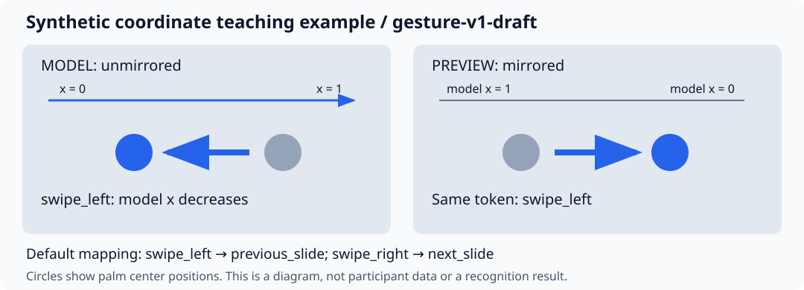

# T05 手势协议 v1 草案

> **public-data-v1迁移待实施**：最新路线采用公开数据，首选IPN HandS候选，不能将其Open twice/Grab强行改成下文静态张掌/握拳。首版拟使用UI/键盘启停，保留来源类别并只对经核对的左右动作发候选命令。下文与当前配置仍为旧5类草案，不代表新数据已有合法映射；迁移时统一升级协议/契约/测试。见 [公开数据方案](public_data_plan.md)。

版本 `gesture-v1-draft`；2026-10-29。固定 ID 与初始语义供 T06/T09/T11/T13/T17/T18 共同使用；**具体形状/阈值尚未经过真实 pilot，不标记最终冻结**。参数权威来源为 `configs/gestures.yaml` 和 `configs/interaction.yaml`；任何变更同时更新契约、数据标签、模型类表与报告。

## 坐标、姿态与运动证据

模型输入不镜像，x 向图像右侧增大、y 向下增大；左右是模型图像方向。旋转先在输入适配层统一为正立图像并记录 `rotation_degrees`。手机前置预览可以镜像，模型坐标不随预览改变。

掌心位置取 0、5、9、13、17 号点平均；xy 分别按图像宽/高归一化。四指是食/中/无名/小指，不含拇指。PIP 角以 MCP–PIP–DIP 的夹角表示，≥150°算伸展，≤100°算屈曲，介于两者为不确定；四指依次使用 (5,6,7)、(9,10,11)、(13,14,15)、(17,18,19)。关键点仅是辅助标注测量，可见原图是边界判断依据；检测失败不能删除真实动作或推迟真值。无法判断则屏蔽对应监督。

低速阈值为掌心二维位移欧氏长度/源时间间隔 ≤0.05 图像宽度/秒；计算时 y 位移乘 H/W，保证与 x 相同单位。不得用帧号当时间。首版中性区为 x∈[0.2,0.8]、y∈[0.2,0.8]，中性手型为四指中仅1～3指明确伸展、其余明确屈曲，连续可见且低速 ≥400ms；不确定手型不算释放证据。静态保持期间相邻可判断源帧间隔超过100ms则中断保持计时，该时间间隔也是 pilot 待核验起点。

## 词表、参考确认与释放

| ID / 类别 | 可见成立规则 | 参考确认 / 目标 | 释放/恢复 |
| --- | --- | --- | --- |
| 0 no_action | 可见且不满足其他词元；无手背景可标背景，但感知缺失另标质量 | 无目标事件 | 仅明确中性手型＋低速＋区域＋400ms才构成重新武装证据 |
| 1 wake_open | 四指均明确伸展、掌心低速；拇指不作硬限制 | 从可见稳定成立起点加600ms；有明确请求时 target=request_control；须 UI 先启用 | 先经过中性停留再接受离散命令；真正 owner 逻辑在 T17 |
| 2 swipe_left | 从可见横移起点起，掌心 x 减少≥0.18图像宽度；持续150～1500ms，期间掌心 y 最大跨度≤0.15图像高度 | 首个达到位移且已满150ms的源帧；默认 previous_slide | 反向回程可标 swipe_right，但 intent=0、无第二目标；中性停留后再武装 |
| 3 swipe_right | 同上，x 增加≥0.18图像宽度 | 同上；默认 next_slide | 同上，反向回程可标 swipe_left |
| 4 exit_pose | 四指均明确屈曲的握拳候选且掌心低速；不依赖拇指位置 | 可见稳定起点加800ms；target=exit_control | 清 owner 与待执行动作；恢复须重新启用/唤醒；不是唯一紧急停止 |

挥动有效区间从事后可确认的可见横向运动起点开始，到该方向运动结束/反转前结束。参考确认时刻是在该区间内首个满足方向位移与时长的可观察时刻，不以模型输出或片尾决定。若已满1.5s仍未满足位移，不能标为完整 swipe 正例；确实可见但未完成的准备段 class_valid=false。纵向跨度在从起点至候选帧的可见轨迹上核对。动态规则满足时优先标 swipe，张掌只是该运动的手型，不能同时标 wake_open。

静态姿态从可见形状与低速同时成立的第一帧开始给类别标签，之后才按保持时长定义参考事件。100ms 张掌片段仍可有 wake_open 类别，但因保持不足无目标事件；不能等600ms后才开始标 wake_open，再让状态机等待600ms。exit_pose 同理。

释放阶段不按“冷却结束”“置信度下降”或“回到中心”单独判定。回到中心时仍在运动或仍是张掌/握拳，均不算中性释放。等待释放时短缺失也不构成释放；实际安全挂起/owner 恢复由 T17/T24 实施并验证。

## 模式与意图

首版 presentation：swipe_left→previous_slide、swipe_right→next_slide；no_action/wake_open/exit_pose 不直接映射设备命令。以后可以在独立模式映射到 previous_track/next_track 等能力，但需 T21 实现与验收。使用者习惯由显式映射决定，不能改旧类别方向含义。首版标注验证器仅支持已登记的方向映射，调整映射时必须同步协议版本和验证器。

自然交流与指令挥手使用**相同可见类别**，intent 分别为0与1。intent 仅描述协议约定请求，并非推断心理。参考事件只给明确操作请求；唤醒/退出分别作为控制事件计分，翻页作为设备事件计分。未训练意图头时输出保留 null，不声称模型理解自然动作意图；防误触依赖显式启用、owner、释放与停止，并要实测激活状态下的自然动作。

## 每类正例、反例与不确定案例

以下均为自行编写的**纯合成教学情境**，不是采集结果或动作识别效果。允许公开的 JSON 区间见 `tests/fixtures/annotation_examples.json`；它只验证标签关系，不验证真实图像的可区分性。

| 类别 | 正例 | 反例/易混淆 | 不确定处理 |
| --- | --- | --- | --- |
| no_action | 放松中性手、端杯且不满足词元、可确认无手背景 | 完整自然左挥也应为 swipe_left、intent=0；不是 no_action | 遮挡致手型/方向不可判断：class_valid=false |
| wake_open | 掌心低速、四指伸展≥600ms，有请求且UI启用 | 三指伸展为 no_action；张掌横移满足 swipe 时标 swipe | 指尖被遮挡或侧面导致角度不可判断：屏蔽类别 |
| swipe_left | x从0.65减至0.40，300ms，y稳定；请求上一页 | 向右为 swipe_right；自然左挥类别相同但无设备目标 | 位移不足/准备段无法确认：class_valid=false；不确定意图单独屏蔽 |
| swipe_right | x从0.35增至0.60，300ms，y稳定；请求下一页 | 从右挥位置返回左侧是回程左挥，无第二目标；仅静态在右侧不算右挥 | 检测丢失时看原视频；原图也不可判断则屏蔽 |
| exit_pose | 四指屈曲握拳低速≥800ms，明确退出请求 | 普通握杯且不满足握拳规则为 no_action；100ms握拳有类别但无退出目标 | 拳头遮挡或角度不明则屏蔽；立即停止仍靠独立路径 |

完整教学序列：背景 → 明确启用 → 张掌唤醒 → 中性停留 → 右挥目标 → 左向回程（无目标） → 中性停留 → 左挥目标 → 中性停留 → 握拳退出。不能把回程自动切成新的反向命令。

## Pilot 冻结条件

T06 记录授权与完整源时间轴后，T07 让 A/B 对同一短片独立标注并讨论分歧。核对左右/镜像、静态起点、位移参考、自然动作意图、回程和中性释放；每类补至少一组获许可的真实正反例。记录类别/意图一致率、边界时间偏差与未解决案例，再冻结数值并升级版本。当前没有这些真实证据，不能以合成测试代替。
