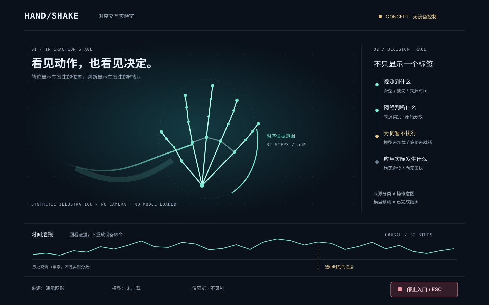

# T36/T20：时序交互舞台，而不是卡片仪表盘

**2026-10-31更新：Linux原生合成原型已实现并完成构建/集成测试，见[技术决策与运行证据](native_stack_decision.md)。真实相机/模型/应用及其他平台仍待验。下方保留2026-10-30的概念与历史预检，不作为最新实现状态。**



上图为自行绘制的SVG设计稿。骨架和轨迹均为示意，不是摄像头截图、模型实测或已运行的Flutter界面。

## 交互的主角是动作过程

1. **中央舞台**：主要空间留给相机/骨架，轨迹尾迹仅表示已发生的历史，方向/缺失直接出现在发生的位置。镜像仅是显示变换，不暗改模型词元方向。
2. **时间透镜**：底部不是一排统计卡片，而是一条最近32步的证据时间轴。选中时刻查看来源时间、质量、窗口就绪和模型输出；回看只读，不重新发设备命令，不以插值制造新感知帧。
3. **决策轨迹**：右侧窄列依次显示“观测到什么→网络判断什么→为何执行/拒绝→应用实际发生什么”。原始logit不画成已经校准的概率，未加载模型不播放假预测。
4. **两种观看方式**：操作模式简洁低干扰；讲解模式展开TCN感受野、缺失掩码、来源类与应用候选，方便答辩解释深度学习链路。不是改运行状态来得到漂亮指标。
5. **停止永远可见**：底部固定停止入口，键盘可达并有文字/图标；收到停止请求与确认安全静止分开显示。窗口Esc不是OS全局停止，UI失联也不能是唯一停止渠道。
6. **窄屏不是卡片堆叠**：保留舞台和停止入口；决策轨迹切换为可展开侧栏，时间透镜可横向查看。扩大字体、减少动画、色盲和读屏均需另做实测。

拒绝原因是产品交互的一部分：例如多手、过期、缺帧、尚未校准、目标不确定，给可理解的恢复方式；不只有红灯和“失败”。

## 技术选择：Flutter优先验证，Python保留在合适的位置

- **Python**：数据审核/导入、PyTorch训练、共享特征、桌面参考推理和安全核心。训练与应用动作不是UI代码，没必要为跨平台重写一遍训练栈。
- **Flutter/Dart候选**：原生多端壳、绘制舞台/时间透镜、触控/键盘交互与平台生命周期。选择理由是同一套可定制绘制与交互框架有望延续到手机，不是“一套二进制到处运行”。
- **桌面桥接候选**：启动本机核心子进程，以版本化的只读快照和受控命令通信；明确会话代际、序号、过期、断连及超时。原始相机帧需要有界传输，不把每帧大JSON塞进UI事件队列。
- **移动端**：未来使用平台相机/MediaPipe插件与经过一致性验证的模型运行时，不能让手机依赖桌面Python服务，也不承诺跨App任意注入。
- Qt是保守桌面备选，不同时维护两个正式UI。未完成Flutter首桌面启动/通信/停止验证前，不宣称T36已经冻结或T20已经交付。

### 本轮技术预检

本机有CMake、Clang和GTK3（pkg-config报告3.24.52），没有现成Flutter/Dart/Ninja命令。尝试从Flutter官方stable分支浅克隆，限定时间内未完成；没有生成Flutter锁文件、编译产物、窗口或widget测试结果。**因此本轮交付设计稿，不提交一堆未经编译验证的Flutter占位代码。** 下一轮首先取得可验证SDK版本，补首个原生mock原型及测试，再锁定依赖。

## 架构与代码规范依据

本轮实际查阅：

- [Flutter官方架构建议](https://docs.flutter.dev/app-architecture/recommendations)：关注点分离、MVVM、单向数据流、不可变模型、依赖注入、独立测试和fake数据源。
- [Effective Dart：Style](https://dart.dev/effective-dart/style)：文件/目录lowercase_with_underscores、类型UpperCamelCase、成员lowerCamelCase、格式化和清晰控制流。

将采用这些可验证的工程原则，不照抄别人的产品布局，不为简单功能增加无用的repository/use-case层。域层只在确有独立复杂规则时引入。

```text
不可变核心快照 → CoreRepository / UI ViewModel → 舞台、时间透镜、决策轨迹
用户操作       → 类型化意图                  → 核心验证、状态机、唯一调度器
```

- Widget只处理布局、展示、输入与必要动画；不能训练网络、改模型类表、猜控制权或直接注入按键。
- 来源协议对象与视图状态分开，UI使用明确的Disconnected/Preview/Unavailable等状态，不用一堆互相矛盾的布尔值。
- 时间戳跨语言序列化要无损；未知版本、旧epoch、重复/晚到快照拒绝。暂停、回看、失联后绝不补执行旧动作。
- UI状态机和缓存不是安全核心的副本；“优雅”来自边界清楚，而不是大量抽象或设计模式名称。

## 后续原型验收

1. Flutter桌面可构建/启动，有锁定SDK和依赖，能显示带synthetic标记的可替换快照。
2. 在无模型/无相机/断连时仍可解释地显示状态；不以空白页或假分数掩盖。
3. ViewModel单测、widget交互/窄屏/字体缩放测试、骨架与原图对齐测试。
4. 核心通信有超时和反压，停止不依赖下一帧；窗口内快捷键与全局停止能力分开验收。
5. 再接T16真实模型包与T19明确应用目标，完整实机控制归T23/T24。
