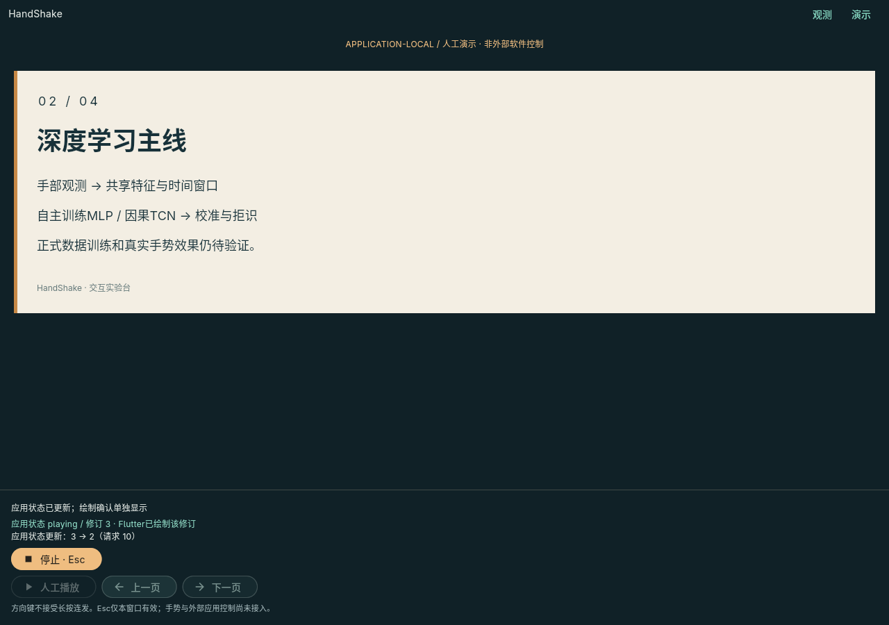

# T19阶段一：原生内置演示应用

> 本文为人工演示阶段的历史说明。目前已增加同窗口的[实时手势翻页预览](native_gesture_preview.md)，使用 `uv run app`。原人工演示页和影子页仍保留各自权限边界；真实相机成功率仍未验收。

**分支 `feat/presentation-application`，基于拉取后的master `13839c9`。** 前一轮`feat/public-data-scale`已推送，但尚未合入此基线；本功能不依赖数据分支，也没有在本机训练神经网络。



截图仅导出本应用自己的四页示例稿，测试画布1280×900，不是用户桌面或相机截图。示例不包含正式训练成绩。

## 能做什么

- 在同一个Flutter原生窗口切换“观测”和“演示”。
- 进入演示先预览，**点击人工播放才授权翻页**；按钮和窗口内左右方向键控制上一页/下一页。
- 固定四页纯文本演示稿来自`shared/defaults/presentation_demo.json`，核心持有实际页码和修订号，Flutter显示对应页面。
- 页面边界不回绕，回执明确标注`boundary_no_change`；长按方向键不连发。
- 停止、切回观测、窗口隐藏/后台或失去活动状态时停用内置控制。恢复后不自动播放。

**明确的范围：application-local、人工操作。** 这不是PowerPoint/WPS/LibreOffice后端，也不是模型驱动翻页；不注入系统按键、不控制其他窗口，不把来源分类当操作意图。本机没有LibreOffice，Wayland外部输入权限/目标查询未验证，所以没有声称外部演示软件受支持。

## 运行

```bash
# 项目根目录；Flutter已在PATH，或指定 --flutter /path/to/flutter/bin/flutter
.venv/bin/python scripts/run_native.py

# 已构建Release时，不需要通过Flutter工具启动
.venv/bin/python scripts/run_native.py \
  --bundle frontend/native/build/linux/x64/release/bundle/handshake_stage
```

进入窗口后点击右上角“演示”→等待页面绘制确认→“人工播放”→上一页/下一页。Esc仅本窗口有效，不是系统全局停止。普通演示不需要摄像头、MediaPipe资产或训练模型。

当前没有PPT/PDF导入、任意文件读取或全屏第二窗口；固定示例稿用于先验证应用与安全边界。

## 核心设计

```text
原生Presenter ViewModel（用户明确意图）
  → 私有NDJSON子进程 / PresentationSession
  → 标准ActionCommand / 唯一T18 Dispatcher
  → PresentationBackend（真实应用页码状态）
  → application结果 + 只读页面快照
  → Flutter绘制回调 / render_ack
```

### 不绕调度器、不伪造手部控制者

`backend/presentation.py`拥有控制器、一个dispatcher和一个内置后端。所有导航都生成标准`next_slide/previous_slide`命令，经过能力白名单、目标、上下文、TTL、去重及串行提交。

T18新增可选的**可信宿主授权检查**接口，仅本应用人工控制显式提供。默认手势路径仍要求真实owner track，没有放宽旧行为。人工控制的`owner_track_id`保持None，不能制造`manual-hand`冒充感知轨迹；服务自行验证人工授权、已绘制修订、心跳和唯一目标。

内置目标绑定演示稿SHA256，命令不接受任意目标/文件/脚本参数。后端在同一提交gate下复核状态并修改页码，不持有OS输入句柄或按键。模型/相机子进程仍然只读，没有把分类结果自动转交这个手动入口。

### 两种确认不能混为一谈

1. **应用状态更新**：后端确实更改了自己管理的页码，返回`ActionResult(acknowledgement_level=application)`。这里复用的`injection_status=confirmed`表示应用适配调用成功，**不是OS键盘注入证明**。
2. **Flutter绘制确认**：当前可见演示组件的post-frame回调确认相应epoch/revision已参与Flutter绘制。新页未确认前不接受下一次导航。

绘制确认不是屏幕硬件光学测量，也不证明用户看到了未遮挡窗口。已经提交/完成的翻页不能被stop倒退撤销；不确定结果不自动重试。

## 私有协议与停止

规范见[协议代码](../shared/presentation_protocol.py)和[schema](../shared/presentation_protocol.schema.json)。它与相机HSP2/HSP3通道分离，没有新开放网络端口；`python -m backend.presentation_cli`只是由UI创建的本机管道子进程。

- 命令限定play/next/previous/stop/heartbeat/render_ack/shutdown，严格字段、版本、session和递增command ID。
- 每条普通命令携带收到的epoch、page revision及`based_on_sequence`。核心保留32个快照引用，普通请求引用超过500ms即停用，不能在接收旧请求时重新启动完整TTL。
- 这是核心快照引用的新鲜度，不是物理键盘事件时间或跨设备时钟同步证明。T38不能直接复用此协议开放远程访问。
- 1.5秒无心跳停用；新修订1秒没有绘制确认也停用，正常心跳不能替代新页绘制确认；5秒无父端心跳退出。
- UI最多8条未确认小消息，启停/导航确认期限2秒；失联清状态并显示“停止未确认”，不补发操作。
- 仅一个导航在途，dispatcher队列容量1，诊断/上下文历史有界，旧事件/命令仍走T18去重上限。
- stop/shutdown不依赖新帧或渲染确认，先设置停用标志；确认停止还必须同时无在途命令、无队列、完成释放。

当前纯本机内存后端没有阻塞的外部API调用。后续加入外部软件时必须重新核验焦点、权限、迟到副作用和独立释放，不继承本轮“已验证”的结论。

## 验证

- 原生Linux集成测试从实际应用入口切换到演示，完成**1→2→3→2**，逐步核对可见页码、应用回执和绘制确认。
- 同一测试检查方向键长按不连发、Esc停止以及停止后按钮禁用；没有摄像头、外部应用或训练器调用。
- Python覆盖人工授权/缺少绘制确认、过期快照、旧epoch/revision、心跳/绘制超时、页边界、dispatcher去重和停止前后迟到调用；旧手势owner约束继续回归。
- Flutter覆盖严格协议、不可变页面状态、停止确认、失联/重连不自动播放、窄屏和双倍字号。
- 本轮171项不含训练的Python子集、56项Flutter单元/widget及1项原生集成通过；**没有运行完整pytest或神经网络训练**。构建/安装边界见[验证摘要](verification/presentation_summary.json)。

复现原生测试（只控制本应用）：

```bash
cd frontend/native
HANDSHAKE_PYTHON="$PWD/../../.venv/bin/python" \
HANDSHAKE_ROOT="$(cd ../.. && pwd)" \
flutter --no-version-check test integration_test/presentation_smoke_test.dart -d linux
```

可选`HANDSHAKE_PRESENTATION_SCREENSHOT=/absolute/path.png`只保存本应用演示界面。此测试不启用相机；不要拿它作为手势准确率、外部应用或系统全局停止证据。

## 尚未完成

- 外部演示软件适配、版本/权限/焦点的实际平台profile。
- 公开来源类别的draft策略与独立合成页码回放已提供，见[公开策略](public_gesture_policy.md)；正式语义/模型/校准、原生手势接入与真实手势去重仍待验。
- 全局停止、长时间安全/故障/系统生命周期测试、安装器与其他平台。
- 新机器上的正式训练，本机仍按用户要求暂停训练。

T19因此是**内置应用阶段已交付、外部实机部分未完成**，不把mock/内置演示勾成全部完成。
