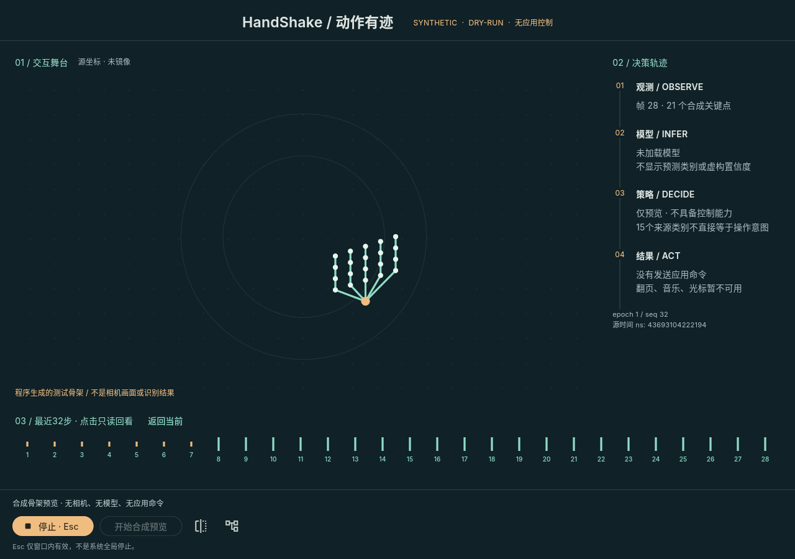

# T36 决策：Flutter原生舞台 + 本机Python参考核心

> **后续增量**：本页是v1合成阶段记录；v2相机/同帧骨架已另行实现，最新运行和证据见[相机阶段](native_camera_preview.md)。下方“尚未接相机”仅描述本页原始交付，不覆盖后续进度。

**2026-10-31 / 第一阶段已实现：Linux原生合成原型；T36/T20整体仍待真实输入与平台验收。**

图像由Linux原生集成测试中本应用的`RepaintBoundary`渲染导出，测试逻辑画布固定为1280×900；不是全桌面截图、真实相机画面或模型识别结果，也不代表该机器实际窗口尺寸。界面中的骨架由程序生成。

## 选定的桌面路线

- **Flutter 3.47.9 / Dart 3.13.7**：舞台绘制、最近32步时间透镜、决策轨迹、键盘和显示镜像。SDK revision见`frontend/native/.metadata`；依赖锁定于`pubspec.lock`，SDK放在仓库外。
- **Python**：保留数据、PyTorch训练、共享特征与桌面参考核心。本轮新增`backend/desktop.py`只是独立的**synthetic-only预览核心**，不接相机、网络、模型、旧5类状态机或应用动作。
- **IPC**：Flutter创建Python子进程，通过继承的stdin/stdout传递有界NDJSON。无HTTP服务、无监听端口、无shell执行请求；stderr独立排空。开发时Flutter自己的调试服务不是产品控制接口。
- **不并行维护Qt版本**：Flutter已经完成首桌面构建与通信探针；Qt仍是未来插件关键路径无法满足时的重新评估方案，不作为第二套产品UI。
- **架构**：严格只读`CoreSnapshot` → `CoreRepository` → `StageViewModel` → Widget/CustomPainter；控件只发类型化操作，不复制推理/安全规则。不为一个窗口加入路由库、数据库或全局服务定位器。

依据：[Flutter架构建议](https://docs.flutter.dev/app-architecture/recommendations)、[Effective Dart](https://dart.dev/effective-dart/style)。Flutter框架为BSD-3-Clause；依赖来自锁文件，运行时没有额外第三方相机/按键插件。未来打包仍需汇总Flutter引擎、GTK与平台依赖的许可通知，不以本轮开发构建替代分发审查。

## 已实现的交互

1. 首次连接保持停止；点击“开始合成预览”后才生成骨架。没有相机或模型也能检查界面，不自动伪造模型回退。
2. 中央留给动作和短历史轨迹，底部逐帧时间轴，右侧解释观测/模型/策略/实际结果。窄屏决策轨迹折叠，内容可滚动，停止区固定。
3. 回看只改变被展示的不可变快照，不暂停核心、不重发命令。历史上限32帧，另保留一个选中快照；epoch变化、断连清除历史。
4. 镜像仅通过统一投影函数影响骨架/轨迹，不改变源坐标。缺手帧不补画当前骨架。
5. 停止请求与核心确认分开，停止超时/断连显示“停止未确认”，不把关闭UI视为设备已安全释放。Esc明确为**窗口内快捷键**。
6. 讲解模式显示深度学习链路和边界；没有网络时不显示预测类别、分数或假感受野。32步是UI历史容量，不等于TCN感受野或固定时长。

## v1桥接协议

规范：[Python契约](../shared/desktop_protocol.py)、[可校验schema集合](../shared/desktop_protocol.schema.json)；Dart解码器见`frontend/native/lib/core/core_snapshot.dart`。

| 字段/消息 | 约束 |
| --- | --- |
| `version` | 必须为整数1；未知版本/能力/字段失败关闭，不协商启用live |
| `session_id` | 子进程生成的32位十六进制会话标识；每次重连更换，不是网络认证令牌 |
| `sequence`、`epoch`、`command_id`、时间 | 最多19位规范十进制字符串，无前导零；Dart用BigInt，不经过double |
| `timestamp_ns` / `frame_timestamp_ns` | 核心单调时钟；后者为**合成生成时间**，不是相机曝光时间。UI不与自己的时钟相减 |
| 快照 | 强制synthetic/dry_run/model unavailable/control false；停止态没有当前骨架/源帧时间 |
| 命令 | 仅`start`、`stop`、`heartbeat`、`shutdown`；命令ID严格递增，开始须匹配epoch |
| 停止 | 允许当前session中的旧epoch停止；提升epoch，延迟开始不能重新启动；不自动重试 |
| 确认 | 快照的`last_command_id`与状态共同确认；回执可合并，不要求逐条ACK队列 |

### 有界性与失联

- 输入一行最多4096字节；UI在UTF-8/JSON解码前限制快照一行最多16384字节。
- 核心约10Hz生成快照；输出邮箱容量1，慢消费者丢中间展示帧，不丢失停止状态。OS管道本身有界；输出阻塞不持有核心状态锁。
- UI每400ms发送心跳，最多8条未确认命令；2秒未收到有效新快照或启停确认即断连并关闭本UI创建的子进程。
- 核心状态线程独立于管道写线程；1.5秒无心跳停止合成预览，5秒失去父端心跳退出。EOF、坏消息、shutdown关闭；关闭只作有时间上限的等待。
- UI丢弃旧sequence/epoch/时间/ACK；换session必须显式重连，重连不自动开始。
- 协议只服务本机私有管道，不可直接暴露为远程接口。没有跨设备时钟同步、新鲜度证明或网络认证，远程仍归T38。

**这些保护当前只停止合成预览。** 它们没有接T17/T18调度器，不构成真实按键释放、全局停止、相机/模型阻塞容错的验收。输出被缓冲的展示帧也不能用来证明真实动作新鲜度；接真实控制前必须扩展协议和独立健康路径，不得简单将`control_available`改成true。

## 运行、测试与证据

入口与命令见[原生工程README](../frontend/native/README.md)。本轮验证环境：Linux 7.2.11-arch1-1 x86_64、Wayland桌面会话、GTK3 3.24.52、项目Python3.12。本机GTK窗口启动与管道实测，不是其他Wayland发行版或X11注入支持声明。

- Python新增桥接测试及原有数据/训练/交互全量回归，最终结果见[机器可读记录](verification/native_stage_summary.json)。
- Flutter单元/widget：精确时间、坏协议、字节边界、32帧容量、旧代际、只读回看、停止确认超时、断连、重连、镜像投影、1280/360宽度及2倍字体。
- **真实Linux集成**：Flutter启动Python子进程 → 开始 → 骨架 → 回看 → 停止确认 → 关闭核心 → 断连 → 新session重连且保持停止。
- Debug及Release Linux bundle构建；独立Python wheel安装、契约资源、stdin/stdout与EOF通过，wheel不含Flutter子工程。
- `flutter analyze`、Dart格式与新增Python静态检查通过。测试使用合成骨架，无真实数据或正式训练成绩。

早期一次全量回归期间编辑了共享协议，训练恢复检查因此拒绝代码身份变化；冻结代码后重新全量运行。未关闭身份校验来绕过失败。另一次原生探针误将虚拟环境解释器做了symlink解析，丢失venv依赖而失败；最终探针及启动器保留venv解释器路径。

## 尚未完成与下一阶段

| 能力 | 本轮结论 / 后续 |
| --- | --- |
| 相机纹理/感知帧通路 | 未接入；需有界图像通路、旋转/镜像与骨架一致性、实际FPS |
| 模型加载与真实推理 | 未接入；T15/T16冻结词表/特征/模型包、校准与拒识契约 |
| 公共类别应用策略与翻页 | 未实现；先明确目标应用和启停/释放规则，再接唯一调度器 |
| 独立全局停止/系统休眠/崩溃 | 只验合成核心失联；真实动作释放/时延、后台权限归T23/T24 |
| 安装包/分发 | 有开发机Linux bundle；无安装器、离线Python打包、签名或干净系统安装证据 |
| 无障碍/高DPI | 自动化布局/语义与字号测试；读屏、触控、缩放和人工视觉体验仍待实测 |
| Windows/macOS | 未生成/构建宿主；需各平台工具链、插件、相机与应用能力逐项验证 |
| Android/iOS | 未构建；不能运行本轮Python子进程方案当作手机本地核心 |

### T37交接约束

Android/iOS保留Flutter视图和不可变快照接口，但用平台相机、MediaPipe与本地模型运行时替换repository后端，不让手机依赖电脑Python服务。相机权限/后台释放、YUV/BGRA方向转换、特征与logits的golden一致性、算子与量化误差分别验收。Android需SDK/JDK/NDK/签名与真机；iOS需macOS/Xcode、证书/provisioning及真机。APK/IPA、手机热/电量与跨App能力本轮均无证据，保持未验证。
