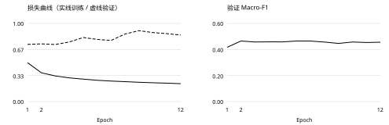
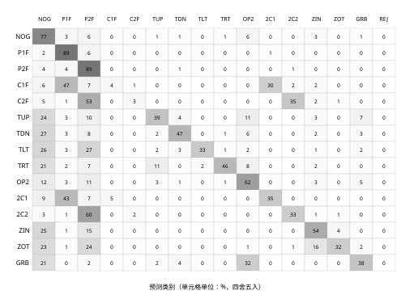

# HandShake：基于手部关键点的动态手势识别

人工智能课程项目报告 · 2026年11月3日

组员1：________  学号：________    组员2：________  学号：________

## 1  背景与目标

非接触式手势交互可用于演示翻页等场景，但连续画面中的自然动作、遮挡和用户差异会引起误识别。本项目使用现成的 MediaPipe 提取手部关键点，自主实现并训练轻量级因果时间卷积网络（TCN），研究连续手势的15分类识别，并构建 Linux 桌面可视化原型。

目标分为两层：①输出手势类别并用客观指标评估；②将识别与执行分离，在启停、控制手选择、时效与防重复约束下观察翻页候选。当前交付包含只读识别/候选预览和独立人工翻页，不把离线分类结果宣称为已验证的实时手势控制能力。

## 2  数据与预处理

使用 IPN HandS 的图片帧 MediaPipe Hands 关键点及时间标签，类别为14种手势加非手势 NOG，共15类。来源包共200个序列、801,476帧；按原始30 fps时间轴对齐关键点与标签，不执行数据包内脚本。公开数据及派生处理遵循 CC BY 4.0。

| 集合 | 序列数 | 有标签缓存端点 |
| --- | --- | --- |
| 训练 | 116 | 334,604 |
| 验证 | 32 | 99,909 |
| 测试 | 52 | 本报告未使用测试成绩 |

划分按50个来源采集组整体隔离，保留官方测试组，仅从官方训练组中固定划出验证组；同组四个序列不跨集合，不进行逐帧随机切分。采集组不是独立核实的人员身份，因此只能报告采集组留出结果，不能宣称已认证的跨人泛化。

预处理：核对文件哈希和帧/标签范围；无手、多手及不确定标签不伪造为正常单手监督；以腕点为原点、掌尺度归一化，保留全局位置与运动；均值/尺度统计只在训练集拟合，验证/测试复用。每帧含63维局部坐标、10维运动/状态、21维有效性掩码，共94维；使用最近32帧因果窗口。缺失、超时和暖机状态单独记录，评估不因未就绪而删除有标签端点。

## 3  技术方案

相机 → MediaPipe 21点 → 94维特征 → 32×94时序窗口 → TCN → 15类分数 → 独立交互策略。TCN采用94→64映射，4个因果残差卷积块，卷积核3、扩张率1/2/4/8，取最后时间步分类；不使用未来帧。MLP是代码中保留的单帧对照，本次没有收到其正式训练结果。

训练用交叉熵与 AdamW；模型负责分类，绝不直接生成系统输入。Flutter界面与Python核心通过受约束协议通信，启动默认停止，断连与失跟撤销控制意图。

---

## 4  训练配置与验证结果

训练机：Windows 11 / NVIDIA GeForce RTX 5060 Ti；PyTorch 2.11.0+cu128。batch=64，学习率=0.001，权重衰减=0.0001，随机种子=42，最多80轮，patience=10。实际12轮早停，按验证 Macro-F1 与最小改善量 0.0001 选择第2轮。总训练耗时未记录，留待训练者补充：________。

| 指标（未拒识） | 验证结果 | 含义 |
| --- | --- | --- |
| Accuracy | 78.85% | 全部有标签端点中识别正确的比例 |
| Macro-F1 | 46.52% | 各类F1等权平均，重点指标 |
| Balanced Accuracy | 45.55% | 各类召回率等权平均 |
| Weighted-F1 | 78.12% | 按各类样本量加权 |

Precision=TP/(TP+FP)，Recall=TP/(TP+FN)，F1=2PR/(P+R)。这里是窗口末端分类评价，不是独立动作片段准确率；相邻窗口相关，不能将近十万个端点视为独立受试样本。

图1 真实训练日志；选定第2轮。以验证Macro-F1和min_delta=0.0001判断改善，不因低于该幅度的波动替换checkpoint。训练损失下降而验证损失上升时应警惕过拟合。

| 类别 | 样本数 | Precision | Recall | F1 |
| --- | --- | --- | --- | --- |
| NOG | 24,192 | 81.87% | 77.45% | 79.60% |
| P1F | 31,003 | 89.11% | 89.32% | 89.21% |
| P2F | 30,126 | 81.03% | 89.29% | 84.96% |
| C1F | 939 | 17.52% | 4.37% | 6.99% |
| C2F | 968 | 23.24% | 3.41% | 5.95% |
| TUP | 958 | 42.33% | 38.62% | 40.39% |
| TDN | 785 | 33.16% | 47.39% | 39.01% |
| TLT | 798 | 63.72% | 33.46% | 43.88% |
| TRT | 755 | 61.04% | 46.49% | 52.78% |
| OP2 | 1,895 | 35.50% | 62.27% | 45.22% |
| 2C1 | 1,765 | 51.46% | 34.90% | 41.59% |
| 2C2 | 1,774 | 43.59% | 32.58% | 37.29% |
| ZIN | 1,375 | 40.18% | 53.75% | 45.99% |
| ZOT | 1,139 | 60.59% | 32.40% | 42.22% |
| GRB | 1,437 | 49.59% | 37.58% | 42.76% |

---

## 5  混淆矩阵与误差分析

混淆矩阵适用于本项目的多分类任务。行是真实类别，列是预测类别，数值为按行归一化的百分比；对角线越大通常越好。最后一列 REJ 表示拒识/不可用，不是第16个类别。本次阈值0、未拒识，该列全0。

图2 验证集混淆矩阵（灰度底色，全部文字黑色）；原始计数保存在 results.json。

类别明显不平衡：NOG/P1F/P2F共占验证标签的85.40%。它们识别较好，抬高总体Accuracy；Macro-F1只有46.52%，说明15类的平均识别能力仍有限。不能仅用78.85%的总体准确率评价系统可用性。

点击类：C1F召回4.37%，C2F召回3.41%。混淆矩阵可检查它们与指向、双击类别的混淆。指向与点击动作外形相近，加上短动作样本少、末端标签和32帧窗口可能错位，都会影响识别；这些是待验证解释，不是已证实的因果结论。

翻页相关类：TLT（左）Precision 63.72%、Recall 33.46%；TRT（右）Precision 61.04%、Recall 46.49%。离线指标描述未拒识时的漏识别和误分类，不保证真实相机中的动作成功率；抓取与缩放等类别也应分别检验。

后续优先方向：收集/审核短动作与硬负例，尝试类别重加权或分层采样，比较窗口长度与MLP基线，补充跨设备、跨场景测试。所有模型与阈值选择仅用训练/验证集；冻结后再一次性评估测试集。

---

## 6  软件验证、边界与分工

下表引用仓库中2026年11月2日的验收记录（docs/verification/deadline_desktop_handoff.json），是工程测试，不是识别率实验。报告生成日另对交付模型做了哈希、运行契约、golden前向校验，并从分数文件重新计算分类指标，与交付报告逐项一致。

| 验证项 | 已记录结果 | 边界 |
| --- | --- | --- |
| Python非训练回归 | 844通过；4未选中 | 排除6个训练相关测试文件 |
| Flutter单元/组件测试 | 98通过 | 不替代真实摄像头验收 |
| 静态分析与Linux发布构建 | 通过 | 未验收其他桌面/移动平台 |
| MLP/TCN原生影子流程 | 各2项通过 | 程序输入、未训练诊断网络 |
| 真实模型文件与离线分数 | 校验与重算通过 | 不证明现场稳定识别 |

校准补充：在验证分数上选择温度T=1.5、拒识阈值0.6；接受73,076/99,909个端点（覆盖73.14%），其中7,143个错误（接受样本风险9.77%）。满足预设经验风险≤10.00%、覆盖≥50.00%的约束。它仍是同一验证集上的拟合结果，不是独立泛化保证，且整体风险可能掩盖少数类表现；校准不授予动作权限。

未完成的实测：最终测试集与MLP对照、真实相机手势成功率、每分钟误触发、端到端P50/P95延迟、停止后零新增动作和长时间稳定性。以上不得填成0或“通过”。最终测试表：Accuracy ________；Macro-F1 ________；现场动作成功率 ________；误触/分钟 ________；P95延迟 ________。

## 两人分工（下列为职责建议，提交前必须按实际贡献核对并签认）

| 成员（待填真实姓名） | 建议承担的独立工作 | 实际贡献/证据（待填） |
| --- | --- | --- |
| 组员1：________ | 数据核对、划分与特征；TCN/MLP训练、调参和实验记录 | 提交/日志：________
本人确认：________ |
| 组员2：________ | 推理与桌面集成、交互保护、工程测试；指标出图与报告整理 | 提交/测试：________
本人确认：________ |

双方应共同复核数据泄漏、指标口径与结论，并各自说明本人实现和实验；不能以“旁观/观看”替代贡献。当前报告不虚构姓名或已完成的个人工作。

## 7  结论

项目完成了关键点时序分类、真实TCN训练产物接收、验证分析以及受控桌面原型。结果证明模型具有一定手势区分能力，但类间表现差异显著、存在过拟合，实时可靠翻页仍需现场实验。最重要的成果是可复现流程和可核验的结果，而非宣称全部应用功能已经完成。

## 参考资料与复现

[1] Benitez-Garcia等，IPN HandS，Applied Sciences，2025，15(11):6321，doi:10.3390/app15116321。
[2] Lugaresi等，MediaPipe，arXiv:1906.08172，2019。
[3] Bai等，An Empirical Evaluation of Generic Convolutional and Recurrent Networks for Sequence Modeling，arXiv:1803.01271，2018。

实验run：20261102T174832Z-tcn-af17e513。完整哈希、配置与原始计数见同目录results.json。复现命令与提交前检查见README.md。训练曲线和验证混淆矩阵已使用真实产物，不需要后补；最终测试与现场结果仍留空。
